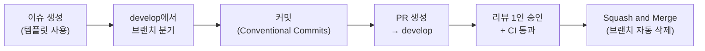

# 협업 가이드

> [← 조직 홈](https://github.com/YC-CapstoneDesign-5) · [아키텍처](docs/ARCHITECTURE.md) · [기능 명세](docs/FEATURES.md) · [로드맵](docs/ROADMAP.md)

## 0. 팀 역할

| 이름 | 역할 | 담당 업무 |
| :--- | :---: | :--- |
| **이규빈** | **PM** | • 프로젝트 총괄, WBS 일정 관리 및 요구사항 정의<br>• 행정 업무 프로세스 분석 및 비즈니스 검증 규칙 명세<br>• 지자체/기관 요구사항 인터뷰 및 최종 발표 총괄 |
| **박희동** | **UI/UX** | • 복잡한 대용량 출석·급여 대조표의 직관적인 데이터 그리드 설계<br>• 오류 하이라이트 및 템플릿 매핑 마법사 화면 설계<br>• 디자인 시스템 구축 및 컴포넌트 표준화 |
| **황규빈** | **Frontend** | • 통합 대시보드 및 검증 결과 비교/재계산 화면 구현<br>• 대용량 데이터 테이블 렌더링 최적화 및 상태 관리<br>• 사용자 인터랙션 및 반응형 웹 레이아웃 구축 |
| **제성준** | **Frontend** | • 비정형 엑셀 업로드 UI 및 템플릿 매핑 마법사 인터페이스 구현<br>• HWPX / XLSX 서식 원클릭 다운로드 연동<br>• 프론트엔드 API 통신 모듈 및 예외 처리 화면 개발 |
| **김정운** | **Backend** | • 참여자·출석·급여 통합 도메인 설계 및 메인 REST API 구축<br>• 출석·급여·4대보험 교차 검증 룰 엔진 개발<br>• HWPX/XLSX XML 문서 자동화 엔진 및 RAG 파이프라인 연동 |
| **김준승** | **QA** | • 교차 검증 룰 엔진 엣지 케이스 및 데이터 정합성 검증<br>• HWPX / XLSX 서식 생성 파이프라인 무결성 및 인쇄 품질 테스트<br>• End-to-End 시나리오 기반 테스트 및 시스템 성능/안정성 검증 |
| **황원경** | **Documentation** | • 기술 명세서, 시스템 아키텍처 다이어그램 및 API 문서화<br>• 지자체별 공공일자리 사업 지침 및 법정 규정 리서치<br>• 기관별 원본 제출 양식 분석 및 템플릿 매핑 정의서 작성 |

---

## 작업 흐름



## 1. 브랜치 및 커밋 규칙

원활한 협업과 변경 이력의 투명성을 위해 엄격한 Git 워크플로우를 준수합니다.

### 브랜치 전략
- 기본 베이스 브랜치는 `main` (운영 배포)과 `develop` (개발 통합)을 기준으로 합니다.
- 모든 기능 개발과 작업은 `develop` 브랜치에서 분기하여 작업 후 PR을 통해 병합합니다.
- **브랜치 네이밍 형식**: `<prefix>/<기능 또는 작업명>` (소문자 및 하이픈 `-` 사용)

| Prefix | 사용 목적 | 예시 |
| :--- | :--- | :--- |
| `feat` | 새로운 기능 개발 | `feat/ocr-pipeline`, `feat/payroll-calculator`, `feat/excel-ingestion` |
| `fix` | 버그 및 결함 수정 | `fix/decimal-rounding-error`, `fix/insurance-matching-null` |
| `docs` | 문서 작성 및 수정 | `docs/readme-specification`, `docs/api-guide` |
| `refactor` | 코드 리팩토링 (기능 변경 없음) | `refactor/clean-payroll-service`, `refactor/ocr-worker` |
| `test` | 테스트 코드 작성 및 검증 | `test/payroll-edge-cases`, `test/e2e-scenarios` |
| `chore` | 빌드, 패키지 매니저, 환경 설정 | `chore/update-dependencies`, `chore/docker-compose` |

---

### 커밋 메시지 규칙

커밋 메시지는 **Conventional Commits** 표준을 따르며, **제목(무엇을)**, **변경 이유(왜)**, **변경 내용(어떻게)**을 본문에 명확히 서술해야 합니다.

#### 1. 기본 구조
```gitcommit
<Type>: <작업 내용 요약 (50자 이내, 명령조/명사형)>

## 변경 이유
- 어떤 문제를 해결하고자 했는지, 어떤 기획/법정 요구사항에 의한 것인지 서술합니다.
- 변경이 필요했던 배경과 맥락을 작성합니다.

## 변경 내용
- 문제 해결을 위해 구체적으로 어떤 로직과 컴포넌트를 어떻게 수정했는지 기술합니다.
- 부수 효과나 데이터 마이그레이션이 있다면 명시합니다.

Resolves: #이슈번호 (선택사항)
```

#### 2. 커밋 타입
- `feat`: 새로운 기능 추가 (예: OCR 파이프라인 추가, 4대보험 귀속 매칭 추가)
- `fix`: 버그 및 오류 수정 (예: 일할 계산 시 주휴수당 누락 버그 수정)
- `docs`: 문서 수정 및 추가 (예: README 명세서 최신화, API 문서 작성)
- `style`: 코드 포맷팅, 세미콜론 누락, 들여쓰기 수정 (로직 변경 없음)
- `refactor`: 프로덕션 코드 리팩토링 (기능 추가 또는 버그 수정 없음)
- `test`: 테스트 코드 추가, 단위 테스트 보강, Fixture 수정
- `chore`: 빌드 업무 수정, 패키지 설치, `.gitignore` 수정 등 기타 작업

#### 3. 모범 커밋 예시
```gitcommit
feat: 4대보험 고지 자료 다차원 귀속 매칭 로직 구현

## 변경 이유
- 공공일자리_필수기능_정의서 04번 요구사항에 따라, 주민번호 단독 매칭 시 발생하는 동명이인 및 타 사업 참여자의 과오납 문제를 방지하기 위함.
- 퇴사자의 과거 환급금이 현재 재직 명단에서 누락되어 정산되지 않는 행정 오류를 차단해야 함.

## 변경 내용
- InsuranceMatcher 서비스 클래스 신설: 주민번호 외에 사업장 기호, 귀속 년월, 부서 배치 이력(PlacementHistory)을 3단계로 교차 검증하도록 구현.
- 매칭 신뢰도가 불확실한 경우 자동 확정하지 않고 VALIDATION_ISSUE 테이블에 CONFIRM_REQUIRED 플래그로 저장하도록 예외 분기 추가.
- 퇴사자 과거 환급 건은 is_refund=True 메타데이터를 유지하여 미지급 목록에서 별도 추적 가능하도록 처리.

Resolves: #42
```

#### 4. 피해야 할 나쁜 예시
- [지양] `fix: 급여 수정` (무엇을, 왜, 어떻게 바꿨는지 전혀 알 수 없음)
- [지양] `feat: 기능 추가함` (추적 불가능한 커밋)
- [지양] `update: ocr.py` (변경 이유와 구현 방식 누락)

---

## 2. PR 규칙

### PR 제목 규칙
`[<Type>] <PR 작업 요약>` 형태로 작성합니다.
- 예시: `[Feat] 출석부 이미지 텍스트 추출 및 비동기 작업 처리 구현`
- 예시: `[Fix] 만 65세 이상 참여자 고용보험 실업급여 요율 공제 예외 처리`
- 예시: `[Docs] 공공일자리 필수기능 정의서 기반 README 전면 보강`

---

### PR 본문 템플릿
PR을 만들면 [PULL_REQUEST_TEMPLATE.md](.github/PULL_REQUEST_TEMPLATE.md)가 자동으로 채워집니다.

---

### 코드 리뷰 및 머지 정책
1. **최소 1인 이상의 승인**: PR은 최소 1명 이상의 동료 개발자 코드 리뷰와 승인을 받아야 머지할 수 있습니다.
2. **CI 빌드 및 테스트 통과 필수**: 정적 분석/린트 검사와 단위 테스트가 모두 성공해야 합니다.
3. **Squash and Merge 권장**: 기능 브랜치의 자잘한 작업 커밋들을 깔끔하게 단일 커밋으로 합쳐서 `develop`의 히스토리를 정돈합니다.
4. **브랜치 삭제**: 머지가 완료된 기능 브랜치는 즉시 삭제하여 브랜치 목록을 청결하게 유지합니다.

---

## 3. 로컬 개발 환경

> **안내**: 본 프로젝트의 기술 스택은 팀 논의를 거쳐 최종 확정될 예정이며, 스택 확정 후 각 파트별 구체적인 로컬 실행 매뉴얼이 공지됩니다. 아래는 `공공일자리_필수기능_정의서` 추천 스택 기준의 환경 구성 예시입니다.

### 1. 요구 환경 예시
- Node.js 18+ 및 패키지 매니저(npm, yarn, pnpm)
- Python 3.11+ (또는 확정 백엔드 런타임)
- 관계형 데이터베이스: PostgreSQL 16+ (또는 MySQL 8.0+)
- 인메모리 큐/캐시: Redis (비동기 OCR 및 대용량 배치용)

### 2. 백엔드 세팅 예시
```bash
# 가상환경 생성 및 활성화
python3 -m venv venv
source venv/bin/activate

# 의존성 패키지 설치
pip install -r requirements.txt

# 데이터베이스 마이그레이션
python manage.py migrate

# 개발 서버 실행
python manage.py runserver
```

### 3. 프론트엔드 세팅 예시
```bash
cd frontend
npm install
npm run start
```

### 4. 비동기 작업 워커 실행 예시
```bash
celery -A config worker --loglevel=info
```

---

## 4. 주의
- 개인정보(주민등록번호 등) 원본은 커밋, 이슈, PR, 스크린샷에 절대 올리지 않습니다. 테스트에는 가짜 데이터만 사용합니다.
- `.env`, 실제 업무 엑셀·스캔 파일은 `.gitignore`로 제외합니다.
