# 시스템 아키텍처

> [← 조직 홈](https://github.com/YC-CapstoneDesign-5) · [아키텍처](ARCHITECTURE.md) · [기능 명세](FEATURES.md) · [로드맵](ROADMAP.md) · [협업 가이드](../CONTRIBUTING.md)

> **문서 상태**: 설계 단계. 기술 스택은 [추천 스택](#10-기술-스택-확정-전) 기준이며 팀 협의 후 확정합니다. 확정되면 이 문서를 먼저 갱신합니다.

## 목차
1. [한눈에 보기](#1-한눈에-보기)
2. [설계 원칙](#2-설계-원칙)
3. [사용자와 권한](#3-사용자와-권한)
4. [모듈 구성](#4-모듈-구성)
5. [시스템 구성도](#5-시스템-구성도)
6. [전체 업무 흐름](#6-전체-업무-흐름)
7. [핵심 파이프라인](#7-핵심-파이프라인)
8. [데이터 모델](#8-데이터-모델)
9. [업무 상태 모델](#9-업무-상태-모델)
10. [기술 스택 (확정 전)](#10-기술-스택-확정-전)
11. [보안 및 데이터 관리](#11-보안-및-데이터-관리)
12. [기술 제약 T1~T4](#12-기술-제약-t1t4)

---

## 1. 한눈에 보기

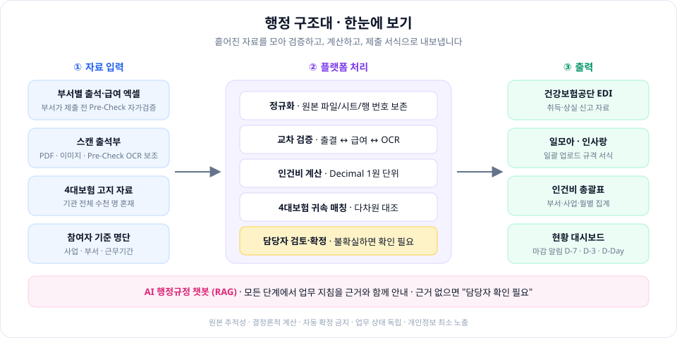

약 60개 부서가 보내는 엑셀·스캔 출석부와 4대보험 고지 자료를 **한 곳에 모아 검증 → 계산 → 대조 → 서식 생성**까지 처리합니다.
부서 담당자는 제출 전에 **Pre-Check**로 스스로 오류를 고치고, 모든 단계에서 **AI 행정규정 챗봇**이 업무 지침을 근거와 함께 안내합니다.

---

## 2. 설계 원칙

모든 설계 결정은 아래 다섯 원칙을 따릅니다. 충돌하면 위에 있는 원칙이 우선합니다.

| # | 원칙 | 의미 | 적용 예 |
| :---: | :--- | :--- | :--- |
| 1 | **개인정보 최소 노출** | 주민번호 등 고유식별정보는 암호화 저장, 화면은 마스킹 | `880101-1******` |
| 2 | **결정론적 계산** | 금액은 규칙 엔진과 십진수(Decimal/NUMERIC)로만 계산. AI가 금액을 정하지 않음 | 급여·보험 공제 |
| 3 | **자동 확정 금지** | 근거가 불확실하면 `확인 필요`로 남기고 담당자가 확정 | 보험 매칭, OCR, 챗봇 |
| 4 | **원본 추적성** | 모든 값은 원본 파일·시트·행(페이지)까지 거슬러 올라갈 수 있음 | 오류 클릭 → 원본 위치 |
| 5 | **업무 상태 독립** | 계산·서식·지급·납부·신고 상태는 서로 자동으로 바꾸지 않음 | 다운로드 ≠ 신고 완료 |

---

## 3. 사용자와 권한

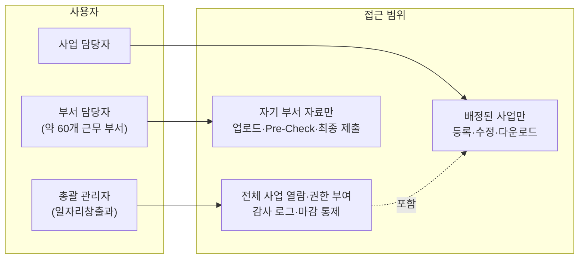

| 역할 | 할 수 있는 일 | 할 수 없는 일 |
| :--- | :--- | :--- |
| **총괄 관리자** | 전체 사업 조회, 권한 부여, 감사 로그, 마감 통제, 지침 문서 관리 | — |
| **사업 담당자** | 배정된 사업의 참여자·급여·보험·서식 처리 | 다른 사업 데이터 접근 (서버에서 403) |
| **부서 담당자** | 자기 부서 자료 업로드, Pre-Check 결과 확인·수정, 최종 제출, 챗봇 질문 | 급여 계산·보험 확정, 다른 부서 자료 열람 |

---

## 4. 모듈 구성

기능 번호는 [FEATURES.md](FEATURES.md)의 번호와 같습니다. 09·10은 [추가 기능 제안](FEATURES.md#추가-기능-제안)입니다.

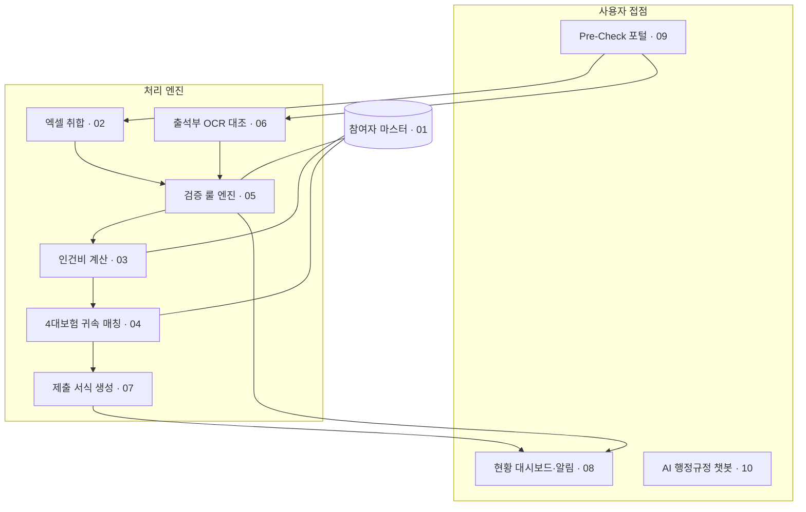

| 모듈 | 책임 | 입력 | 출력 | 기능 |
| :--- | :--- | :--- | :--- | :--- |
| 참여자 마스터 | 사람·사업 참여·부서 배치 이력 관리 | 기준 명단 | 참여자, 배치 이력 | 01 |
| 엑셀 취합 | 부서별 엑셀을 표준 스키마로 정규화 | 부서 엑셀 | 표준 행 + 원본 위치 | 02 |
| 출석부 OCR 대조 | 스캔 출석부 판독 후 엑셀과 비교 | PDF·이미지 | 일치/불일치/미판독 | 06 |
| 검증 룰 엔진 | 누락·중복·기간 외 근무·금액 차이 검사 | 표준 행 | `ValidationIssue` | 05 |
| 인건비 계산 | 근무시간·휴가·중도 입퇴사 반영 금액 산출 | 검증된 근태 | 월별 급여 | 03 |
| 4대보험 귀속 매칭 | 공단 고지 자료에서 참여자분 분리·대조 | 고지 자료 | 보험 내역, 확인 필요 | 04 |
| 제출 서식 생성 | 기관별 템플릿에 확정 데이터 주입 | 확정 데이터 | XLSX·EDI 파일 | 07 |
| 현황 대시보드·알림 | 집행률·미처리·마감 임박 표시 | 전 모듈 상태 | 화면, D-7/D-3/D-Day 알림 | 08 |
| Pre-Check 포털 | 부서가 제출 전 같은 검증 엔진으로 자가검증 | 부서 자료 | 정상/수정 필요/확인 필요, 제출 건 | 09 |
| AI 행정규정 챗봇 | 등록된 지침 문서를 근거로 질문에 답변 | 질문, 지침 문서 | 답변 + 출처 | 10 |

> **재사용 포인트**: Pre-Check(09)는 새 엔진이 아니라 02·05·06을 **부서 담당자가 제출 전에** 호출하는 것입니다. 검증 규칙은 한 곳에만 둡니다.

---

## 5. 시스템 구성도

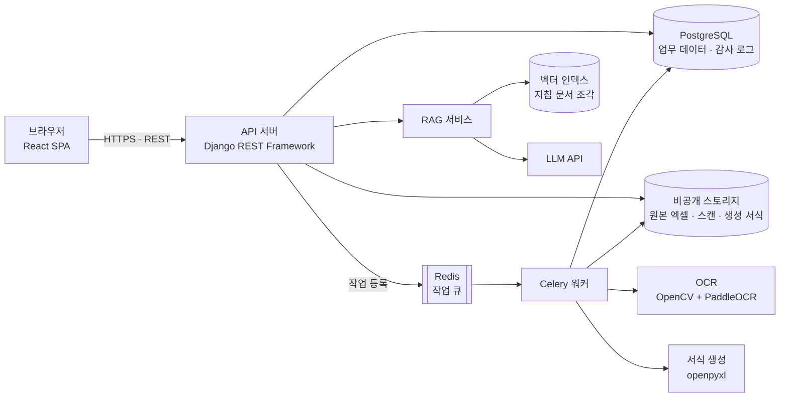

| 구성 요소 | 왜 분리하나 |
| :--- | :--- |
| API 서버 | 권한 검사(RBAC)와 트랜잭션을 한 곳에서 처리 |
| 작업 큐 + 워커 | OCR·대량 서식 생성은 수십 초~수 분이 걸려 요청과 분리. 진행률 표시와 실패 재시도 |
| 비공개 스토리지 | 개인정보가 섞인 원본 파일을 DB와 분리해 접근 제한 |
| RAG 서비스 | 챗봇은 업무 데이터(급여·보험)에 접근하지 않고 **지침 문서만** 검색 |

---

## 6. 전체 업무 흐름

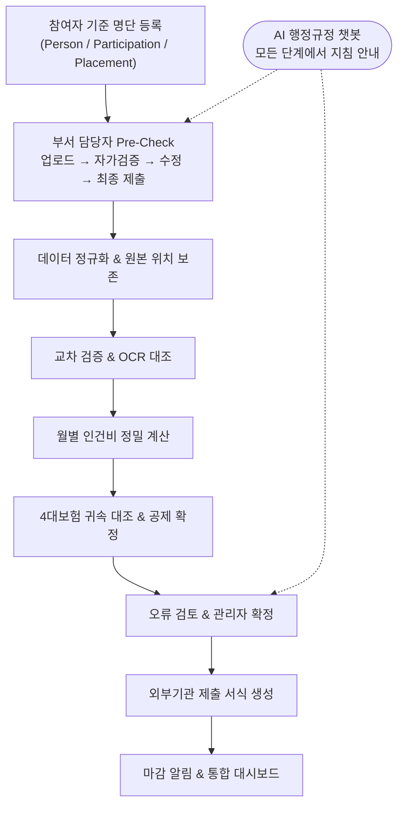

---

## 7. 핵심 파이프라인

### 7.1 부서 제출과 Pre-Check (09)

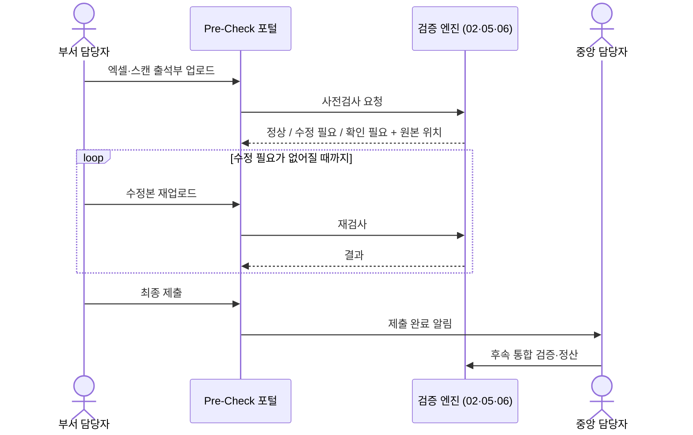

- 결과는 **원본 파일·시트·행·페이지** 위치와 함께 보여줍니다.
- `확인 필요`(OCR 저신뢰, 서명·도장 판독 불확실)는 제출을 막지 않고 중앙 담당자에게 넘깁니다.
- MVP: 업로드 → 기본 검증 → 결과 확인 → 최종 제출. 공가 증빙 판독, 고도화된 서명·도장 판별은 OCR 실험 후 추가.

### 7.2 엑셀 취합 (02)

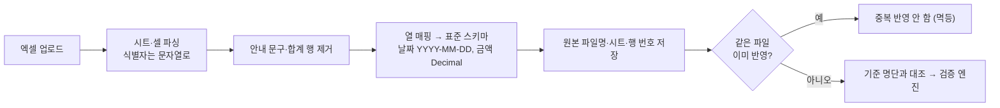

엑셀에 저장된 수식 계산값은 정답으로 믿지 않고 서버에서 다시 계산합니다 (T2).

### 7.3 인건비 계산 (03)

$$\text{실지급액} = \sum \text{승인된 지급 항목} - \text{확정된 근로자 4대보험 공제액}$$

기관 부담 보험료는 근로자 공제액과 별도로 관리합니다. 모든 단계의 산출 근거를 저장합니다.

### 7.4 4대보험 귀속 매칭 (04)

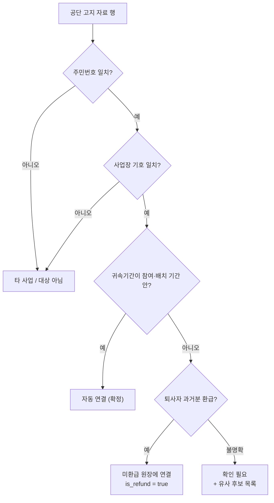

주민번호 **단독** 매칭은 하지 않습니다.

### 7.5 출석부 OCR 대조 (06)

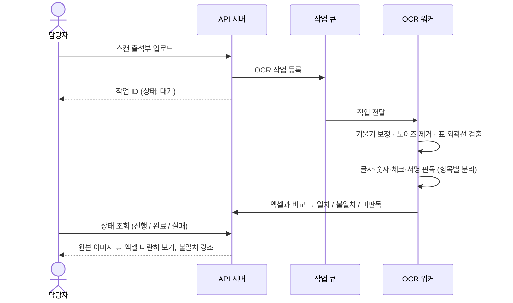

신뢰도 점수만으로 자동 확정하지 않습니다 (T4).

### 7.6 AI 행정규정 챗봇 · RAG (10)

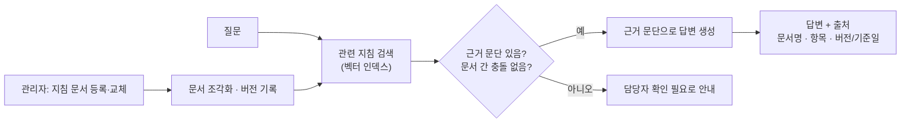

| 업무 | 처리 방식 | 원칙 |
| :--- | :--- | :--- |
| 급여 계산·보험 금액 반영 | 규칙 기반 엔진 | AI가 최종 금액을 정하지 않음 |
| 엑셀·출석부 오류 검증 | 규칙 + OCR | 오류·미판독은 담당자 검토 |
| 업무 지침 질문 | RAG 챗봇 | 등록된 근거 문서 중심으로 설명 |

- 지식 원본: 작성 시 유의사항, 기관 확정 업무 지침, FAQ, 확인된 관련 규정.
- MVP 제외: Text-to-SQL, 자동 의사결정. 챗봇은 업무 DB를 조회하지 않습니다.

---

## 8. 데이터 모델

사람과 업무 이력을 분리해, 부서 이동·재참여·퇴사 후에도 과거 급여·보험 내역이 끊기지 않게 합니다.

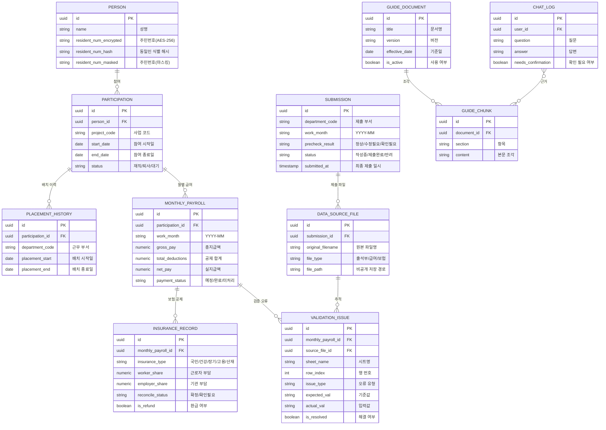

| 도메인 | 핵심 엔티티 | 메모 |
| :--- | :--- | :--- |
| 사람·참여 | `PERSON`, `PARTICIPATION`, `PLACEMENT_HISTORY` | 재참여·사업 이동·부서 전보를 각각 독립 이력으로 |
| 급여 | `MONTHLY_PAYROLL` | 금액 컬럼은 전부 `NUMERIC` |
| 보험 | `INSURANCE_RECORD` | 근로자/기관 부담 분리, 환급 별도 추적 |
| 검증·추적 | `DATA_SOURCE_FILE`, `VALIDATION_ISSUE` | 오류마다 원본 위치 기록 |
| 제출 (09) | `SUBMISSION` | 부서·월 단위 제출 건, Pre-Check 결과 |
| 지식 (10) | `GUIDE_DOCUMENT`, `GUIDE_CHUNK`, `CHAT_LOG` | 답변에 쓴 문서 버전 기록. 업무 데이터와 분리 |

> 09·10 엔티티는 추가 기능 제안 기준의 초안입니다.

---

## 9. 업무 상태 모델

다섯 가지 상태는 **각자 따로** 움직입니다. 서식 파일을 내려받았다고 신고 완료로 바뀌지 않습니다.

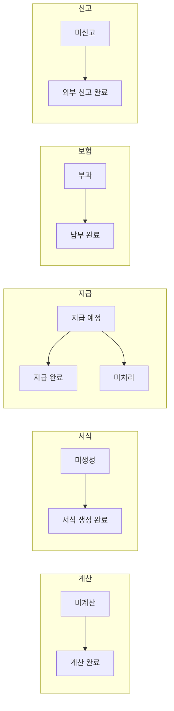

부서 제출 건(`SUBMISSION`)의 상태:

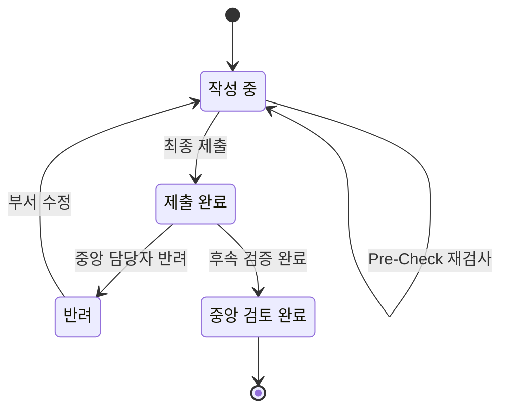

---

## 10. 기술 스택 (확정 전)

| 영역 | 추천 스택 | 이유 | 대안 |
| :--- | :--- | :--- | :--- |
| 프론트엔드 | React + TypeScript + MUI | 대용량 데이터 그리드, 타입 안정성 | Next.js, Vue 3 |
| 백엔드 | Python + Django REST Framework | 복잡한 도메인·룰 엔진, 세부 권한 검사 (T1) | FastAPI, Spring Boot |
| 데이터베이스 | PostgreSQL | 정확한 `NUMERIC` (T3), JSONB, 트랜잭션 | MySQL 8.0 |
| 엑셀 엔진 | pandas + openpyxl | 이종 엑셀 정규화, 원본 서식 보존 주입 (T2) | Apache POI, ExcelJS |
| OCR | OpenCV + PaddleOCR | 표 외곽선 검출, 한글 행정 서식 경량 모델 (T4) | Tesseract, Cloud OCR |
| 비동기 작업 | Celery + Redis | OCR·서식 생성 백그라운드, 재시도 | BullMQ |
| RAG | 벡터 인덱스 + LLM API | 지침 문서 근거 검색·답변, 출처 표시 | 미정 (실험 후 결정) |

---

## 11. 보안 및 데이터 관리

| 영역 | 규칙 |
| :--- | :--- |
| 접근 제어 (T1) | 역할·사업·부서 범위를 **서버에서** 검사. 범위 밖 요청은 403 |
| 고유식별정보 | 주민번호는 해시(동일인 식별)와 AES-256 암호문으로 분리 저장. 키는 환경 변수로 코드와 분리 |
| 화면 표시 | 생년월일·성별 외 뒷자리 마스킹 `880101-1******` |
| 원본 파일 | 타 사업 근로자가 섞인 공단 원본은 비공개 스토리지에 격리, 열람 권한 제한 |
| 트랜잭션 | 업로드·대량 계산은 트랜잭션으로 묶고 오류 시 롤백 |
| 감사 로그 | 모든 수정·확정에 수정자, 일시, 변경 전/후 값, 사유를 불변 기록 |
| 챗봇 | 지침 문서만 검색. 개인정보·급여 데이터는 LLM에 보내지 않음 |
| 개발 | 실제 개인정보·업무 파일은 저장소에 올리지 않음. 테스트는 가짜 데이터 |

---

## 12. 기술 제약 T1~T4

| 코드 | 제약 | 대응 |
| :---: | :--- | :--- |
| **T1** | 사업별 데이터 격리와 세부 권한 | 서버 측 RBAC, 객체 단위 권한 검사 |
| **T2** | 엑셀 파서는 수식을 계산하지 않음 | 캐시된 계산값을 믿지 않고 서버에서 재계산 |
| **T3** | 부동소수점 오차 | Decimal 연산 + DB `NUMERIC` |
| **T4** | OCR 판독 불확실성 | 인쇄 글자·숫자·체크·서명을 분리 검증, 신뢰도만으로 확정 금지 |
