# 시스템 아키텍처

> [← 조직 홈](https://github.com/YC-CapstoneDesign-5) · [아키텍처](ARCHITECTURE.md) · [기능 명세](FEATURES.md) · [로드맵](ROADMAP.md) · [협업 가이드](../CONTRIBUTING.md)

> **문서 상태**: 구현 기준 설계. 구조나 [기술 스택](#10-기술-스택)이 바뀌면 코드보다 이 문서를 먼저 갱신합니다.
> 기능 ID(`FN-xx`, `EX-xx`, `NFR-xx`)는 [FEATURES.md](FEATURES.md)와 같습니다.

## 목차
1. [한눈에 보기](#1-한눈에-보기)
2. [설계 원칙](#2-설계-원칙)
3. [사용자와 권한](#3-사용자와-권한)
4. [모듈 구성](#4-모듈-구성)
5. [시스템 구성도](#5-시스템-구성도)
6. [월간 업무 흐름](#6-월간-업무-흐름)
7. [핵심 파이프라인](#7-핵심-파이프라인)
8. [데이터 모델](#8-데이터-모델)
9. [업무 상태 모델](#9-업무-상태-모델)
10. [기술 스택](#10-기술-스택)
11. [보안 및 데이터 관리](#11-보안-및-데이터-관리)
12. [기술 제약 T1~T4](#12-기술-제약-t1t4)
13. [전제 (가정)](#13-전제-가정)

---

## 1. 한눈에 보기

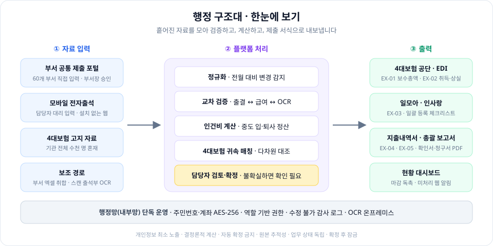

약 60개 부서가 **공통 포털에 직접 제출**하고(FN-09), 담당 공무원은 **모바일로 출결을 입력**합니다(FN-12). 플랫폼은 이 자료를 **검증 → 계산 → 보험 대조 → 기관별 양식 생성**까지 처리합니다.
포털로 제출하기 어려운 부서의 엑셀(FN-02)과 남아 있는 종이 출석부 스캔본(FN-06)은 보조 경로로 받습니다.

모든 구성 요소는 **행정망(내부망) 안에서 단독으로** 동작합니다. 외부 인터넷·SaaS·CDN·외부 메일에 기대지 않습니다 (NFR-05).

---

## 2. 설계 원칙

모든 설계 결정은 아래 원칙을 따릅니다. 충돌하면 위에 있는 원칙이 우선합니다.

| # | 원칙 | 의미 | 적용 예 |
| :---: | :--- | :--- | :--- |
| 1 | **개인정보 최소 노출** | 주민번호·계좌번호는 암호화 저장, 화면은 마스킹. 복호화는 권한자만, 사유 기록. 외부 전송 금지 | `880101-1******`, OCR 온프레미스 |
| 2 | **결정론적 계산** | 금액은 규칙 엔진과 십진수(Decimal/NUMERIC)로만 계산. 엑셀 수식값을 정답으로 믿지 않음 | 급여·보험 공제·중도 정산 |
| 3 | **자동 확정 금지** | 근거가 불확실하면 `확인 필요`로 남기고 사람이 확정 | 보험 매칭, OCR 미판독, 계좌 변경 |
| 4 | **원본 추적성** | 모든 값은 원본 파일·시트·행(또는 스캔 좌표, 입력자)까지 거슬러 올라갈 수 있음 | 오류 클릭 → 원본 위치 |
| 5 | **업무 상태 독립** | 계산·파일 생성·지급·납부·신고 상태는 서로 자동으로 바꾸지 않음 | 다운로드 ≠ 신고 완료 |
| 6 | **확정 후 잠금, 변경은 새 버전** | 승인된 제출본·서명된 청구서는 고치지 않고 새 버전을 만듦 | 재제출·재승인, 재서명 |

---

## 3. 사용자와 권한

역할은 다섯 가지입니다 (NFR-09). 권한 검사는 모두 **서버 API 단**에서 합니다.

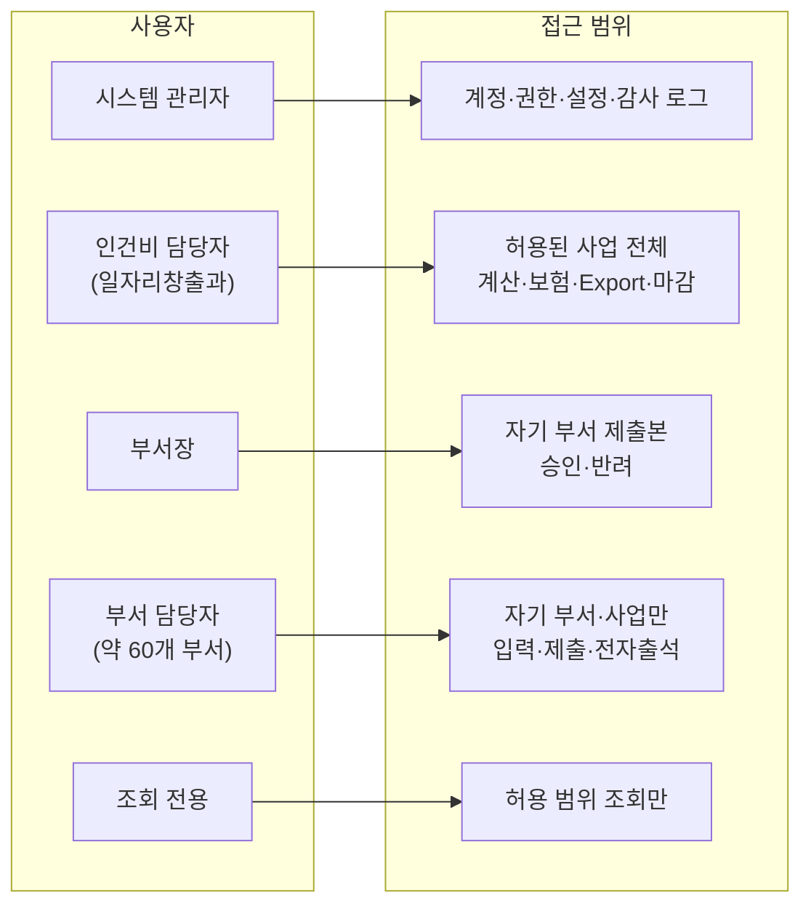

| 역할 | 할 수 있는 일 | 할 수 없는 일 |
| :--- | :--- | :--- |
| **시스템 관리자** | 계정·역할 부여, 양식·단가·연차 규칙 설정(NFR-16), 감사 로그 조회 | 감사 로그 수정·삭제 (누구도 불가) |
| **인건비 담당자** | 허용된 사업의 참여자·급여·보험 처리, Export, 계좌 변경 확인, 마감 일정·독촉 | 허용되지 않은 사업 접근 (403) |
| **부서장** | 자기 부서 제출본 승인·반려(사유 필수), 공문 연결 | 제출본 직접 수정 |
| **부서 담당자** | 자기 부서 자료 입력·업로드·제출, 모바일 전자출석, 확인서 서명 | 급여 확정·보험 확정, 다른 부서 자료 열람 |
| **조회 전용** | 허용된 범위 조회 | 모든 변경, 주민번호 포함 파일 다운로드 |

주민번호가 들어간 파일(EX-01, EX-02, FN-16)은 **출력 권한자만** 내려받을 수 있고, 파일 암호를 걸고 이력을 남깁니다 (NFR-07).

---

## 4. 모듈 구성

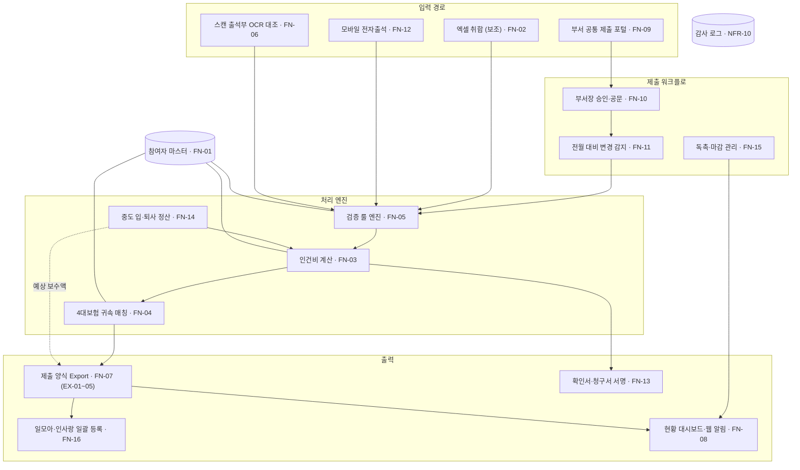

| 모듈 | 책임 | 기능 |
| :--- | :--- | :--- |
| 참여자 마스터 | 사람·사업 참여·부서 배치 이력, 재직자/월 근무자 필터 | FN-01 |
| 부서 공통 제출 포털 | 웹 입력·표준 양식 업로드, 입력 즉시 정규화, 양식 변조 차단, 버전 관리 | FN-09 |
| 엑셀 취합 | 포털을 못 쓰는 부서의 엑셀을 표준 스키마로 정규화 (보조 경로) | FN-02 |
| 모바일 전자출석 | 담당자 대리 입력, 계약시간 기준 인정 시간 계산 | FN-12 |
| 스캔 출석부 OCR 대조 | 스캔본 보정·인식 후 엑셀과 1:1 대조 | FN-06 |
| 부서장 승인·공문 | 승인/반려, 공문 연결, 확정 후 잠금 | FN-10 |
| 변경 감지 | 계좌·계약시간·단가·소속·기간의 전월 대비 변경, 계좌 변경 잠금 | FN-11 |
| 검증 룰 엔진 | 누락·불일치·중복·기간 외 근무·금액 차이 검사, 즉시 재검사 | FN-05 |
| 인건비 계산 | 총 지급액·실지급액·휴가 원장·총괄 집계 | FN-03 |
| 중도 정산 | 일할 근무급, 미지급 주휴, 미사용 연차, 상실 신고 예상 보수액 | FN-14 |
| 4대보험 귀속 매칭 | 다차원 대조, 타 사업분·퇴사자 환급분 분리 | FN-04 |
| 제출 양식 Export | EX-01~05 생성, 합계 일치 검사, 생성 이력 | FN-07 |
| 일모아·인사랑 지원 | 일괄 등록 파일 + 수기 입력 체크리스트 | FN-16 |
| 확인서·청구서 서명 | PDF 생성, 전자서명/스캔 업로드, 금액 변경 시 재서명 | FN-13 |
| 독촉·마감 관리 | 월별 일정, 자동 독촉, 대리 제출 | FN-15 |
| 현황 대시보드·알림 | 인원·예산 현황, 미처리 목록 드릴다운, 기한 웹 알림 | FN-08 |

> **재사용 포인트**: 포털(FN-09), 엑셀 취합(FN-02), 전자출석(FN-12), OCR(FN-06)은 입력 경로만 다르고 **같은 검증 엔진(FN-05)** 을 거칩니다. 검증 규칙은 한 곳에만 둡니다.

---

## 5. 시스템 구성도

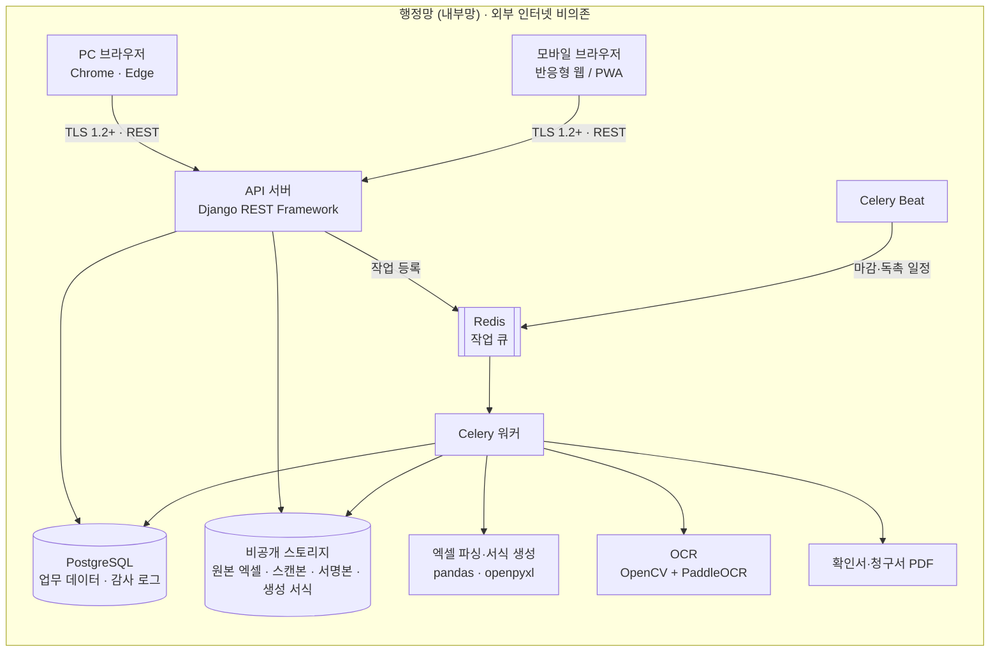

| 구성 요소 | 왜 이렇게 두나 |
| :--- | :--- |
| API 서버 | 권한 검사(RBAC)와 트랜잭션, 감사 로그 기록을 한 곳에서 처리 |
| 작업 큐 + 워커 | 엑셀 대량 검증(NFR-02: 1,000행 30초), OCR(1장 60초), 서식·PDF 생성을 요청과 분리. 진행률 표시와 실패 재시도 |
| Celery Beat | 마감 일정에 따른 자동 독촉·기한 알림(FN-08, FN-15) |
| 비공개 스토리지 | 개인정보가 섞인 원본 파일을 DB와 분리해 접근 제한 |
| OCR 워커 | 이미지가 서버 밖으로 나가지 않도록 **온프레미스**에서 인식 (NFR-08) |
| 정적 자원 | 폰트·스크립트를 CDN 없이 서버에서 직접 제공 (NFR-05) |

---

## 6. 월간 업무 흐름

FN-15의 기본 일정(24일 요청 → 29일 마감 → 30일 최종 독촉 → 익월 1일 지급) 기준입니다.

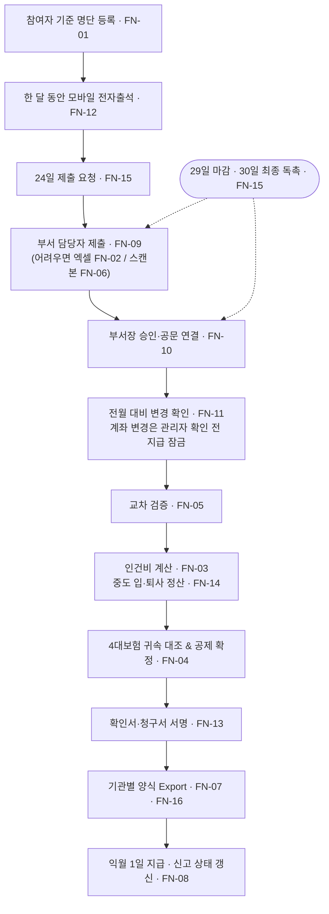

---

## 7. 핵심 파이프라인

### 7.1 부서 제출·승인 (FN-09 · FN-10 · FN-11)

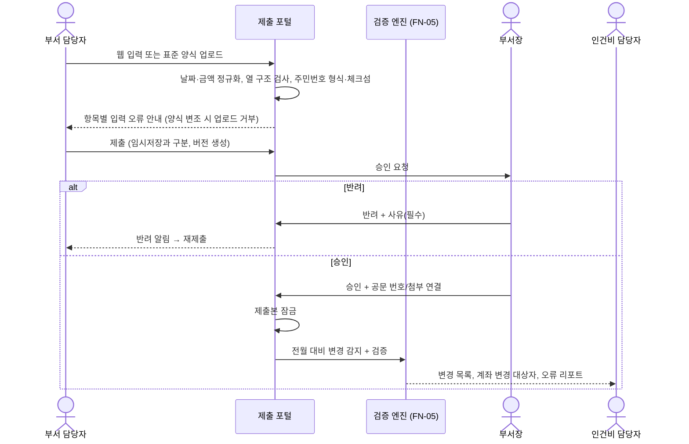

- 확정된 제출본은 직접 수정할 수 없습니다. 바꾸려면 재제출 → 재승인으로 새 버전을 만듭니다.
- 계좌가 바뀐 참여자는 인건비 담당자가 확인하기 전까지 **지급 확정이 막힙니다**.

### 7.2 엑셀 취합 · 보조 경로 (FN-02)

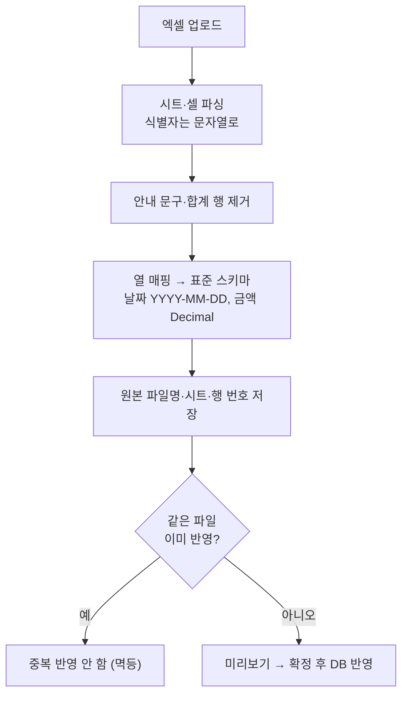

엑셀에 저장된 수식 계산값은 정답으로 믿지 않고 서버에서 다시 계산합니다 (T2).

### 7.3 모바일 전자출석 (FN-12)

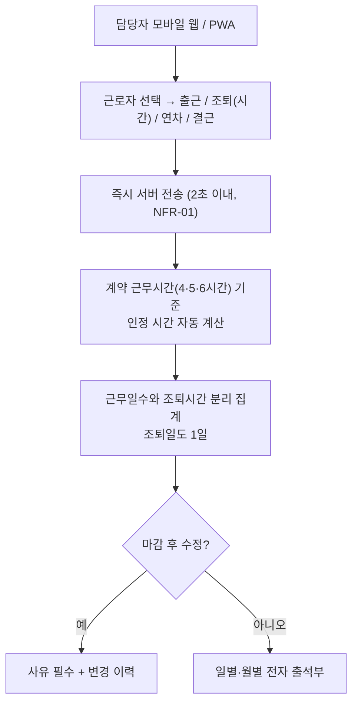

1인 1일 입력은 **3터치 이내**, 한 손 조작이 가능해야 합니다 (NFR-13).

### 7.4 인건비 계산 · 중도 정산 (FN-03 · FN-14)

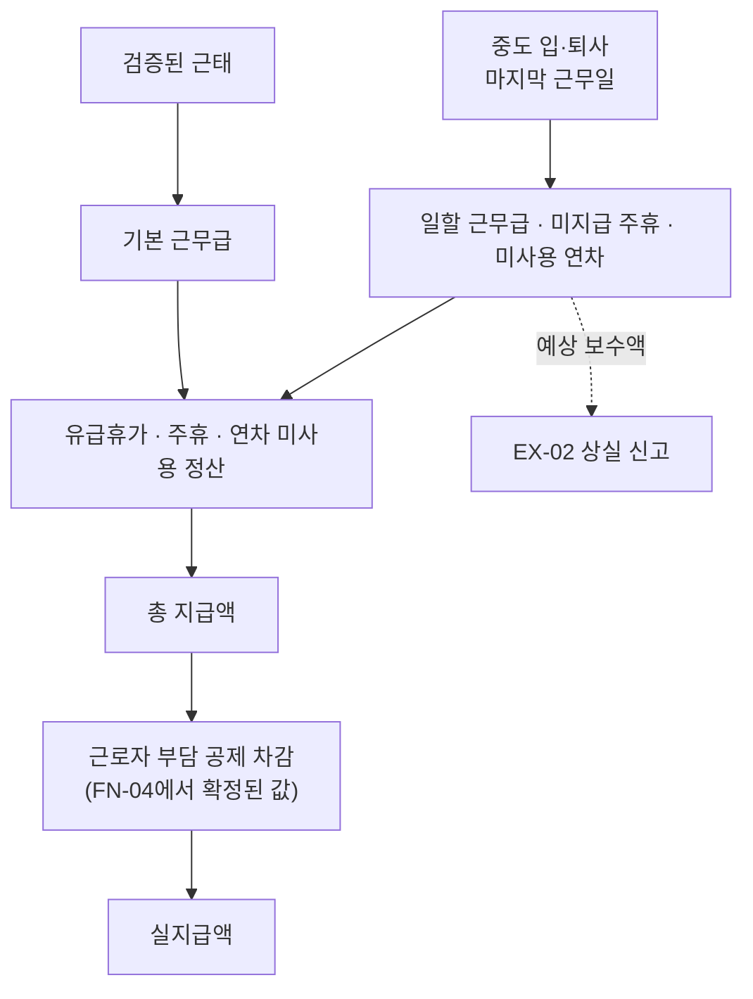

$$\text{총 지급액} = \text{기본 근무급} + \text{승인된 유급휴가·주휴·연차 미사용 정산액}$$
$$\text{실지급액} = \text{총 지급액} - \text{확인된 근로자 부담 공제액}$$

기관 부담 보험료는 근로자 공제액과 별도로 관리합니다. 입력값과 적용 규칙(연도별 단가·반올림·연차 규칙)을 함께 저장해 **같은 계산을 다시 재현**할 수 있게 합니다 (NFR-11).

### 7.5 스캔 출석부 OCR 대조 (FN-06)

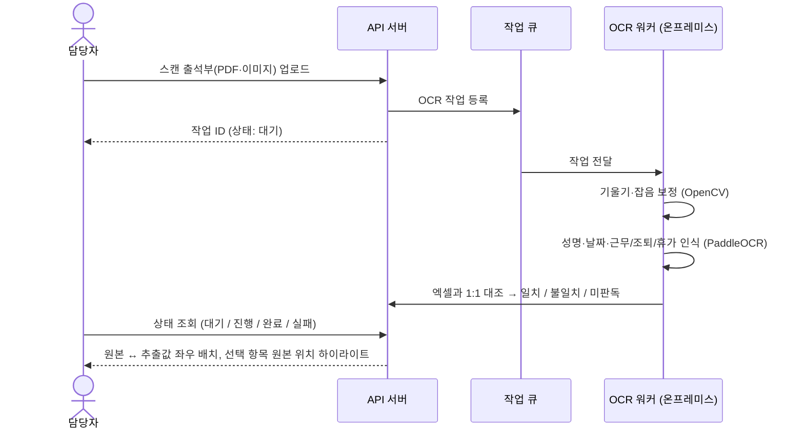

신뢰도 점수만으로 자동 확정하지 않습니다 (T4). 미판독·불일치는 담당자가 수동 보정합니다. 1장당 60초 이내 (NFR-02).

### 7.6 4대보험 귀속 매칭 (FN-04)

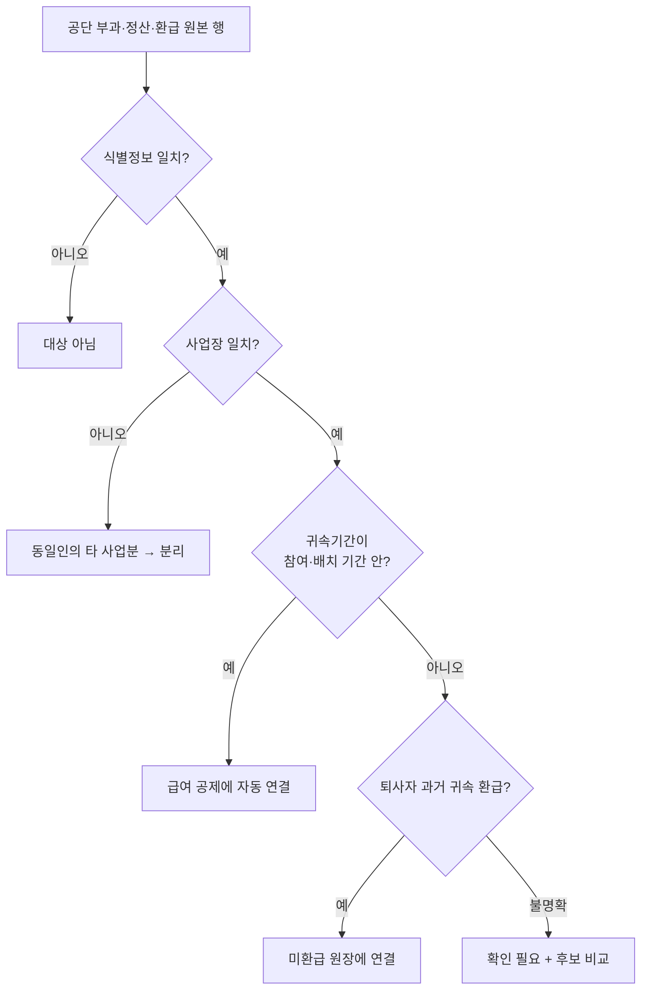

주민번호 **단독** 매칭은 하지 않습니다.

### 7.7 확인서·청구서 서명 (FN-13)

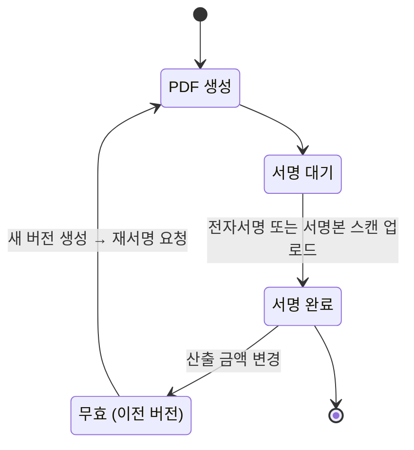

서명본·스캔본은 해당 제출본과 연결해 보관합니다.

### 7.8 기관별 Export (FN-07 · FN-16)

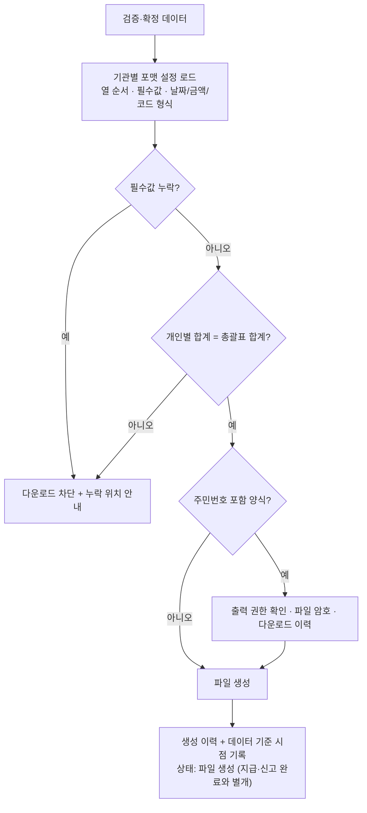

| 양식 | 대상 | 비고 |
| :---: | :--- | :--- |
| EX-01 | 국민건강보험공단 | 귀속 확정 건만, `YYYYMMDD`·원 단위 정수 |
| EX-02 | 4대보험 각 공단 EDI | 입·퇴사자 자동 추출, 기신고자 제외 |
| EX-03 | 일모아 / 인사랑·일사랑 | 표준 헤더 100% 일치, 필수 코드 누락 시 차단 |
| EX-04 | 내부 행정 (일자리창출과·회계) | 기관 부담금 별도 시트/열, 부서 이동자 중복 검증 |
| EX-05 | 내부 총괄 | 개인별 합산 = 총괄 합계 100% |

일모아·인사랑은 API 연계가 불가능하므로 일괄 등록 파일 + 수기 입력 체크리스트까지만 제공합니다 (FN-16).

---

## 8. 데이터 모델

사람과 업무 이력을 분리해, 부서 이동·재참여·퇴사 후에도 과거 급여·보험 내역이 끊기지 않게 합니다.

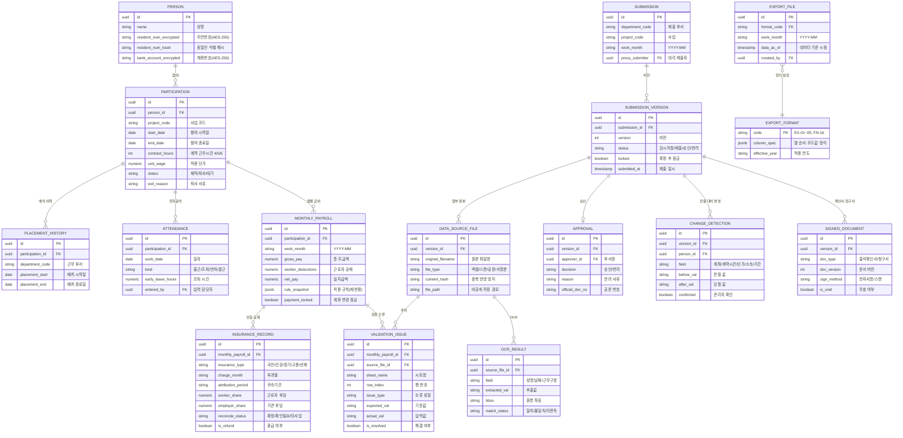

감사 로그(`AUDIT_LOG`: 작업자·일시·대상·변경 전후 값·사유)와 알림(`NOTIFICATION`), 마감 일정(`DEADLINE_SCHEDULE`)은 모든 엔티티에 걸쳐 쓰이므로 그림에서 뺐습니다.

| 도메인 | 핵심 엔티티 | 메모 |
| :--- | :--- | :--- |
| 사람·참여 | `PERSON`, `PARTICIPATION`, `PLACEMENT_HISTORY` | 재참여·사업 이동·부서 전보를 각각 독립 이력으로 |
| 출결 | `ATTENDANCE`, `OCR_RESULT` | 전자출석 원장, 스캔본 인식 결과와 원본 좌표 |
| 급여 | `MONTHLY_PAYROLL` | 금액은 전부 `NUMERIC`, 적용 규칙 스냅샷 저장 |
| 보험 | `INSURANCE_RECORD` | 부과월과 귀속기간 분리, 근로자/기관 부담 분리, 환급 추적 |
| 제출·승인 | `SUBMISSION`, `SUBMISSION_VERSION`, `APPROVAL`, `CHANGE_DETECTION`, `SIGNED_DOCUMENT` | 버전마다 승인·서명·변경 기록 |
| 검증·추적 | `DATA_SOURCE_FILE`, `VALIDATION_ISSUE` | 오류마다 원본 위치, 파일 해시로 중복 방지 |
| 출력 | `EXPORT_FORMAT`, `EXPORT_FILE` | 양식은 설정값(NFR-16), 생성 이력과 기준 시점 |
| 운영 | `AUDIT_LOG`, `NOTIFICATION`, `DEADLINE_SCHEDULE` | 감사 로그는 추가만 가능(수정·삭제 불가) |

---

## 9. 업무 상태 모델

다섯 가지 처리 상태는 **각자 따로** 움직입니다. 파일을 생성했다고 지급·신고 완료로 바뀌지 않습니다 (FN-08).

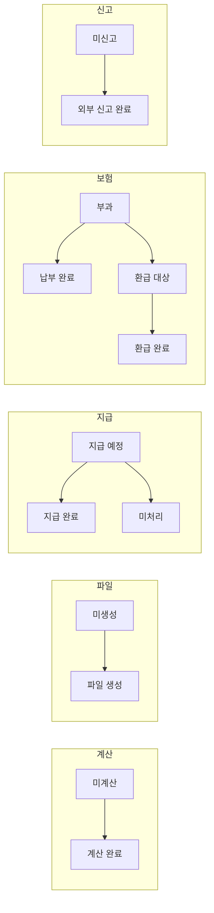

부서 제출본(`SUBMISSION_VERSION`)의 상태 (FN-09 · FN-10):

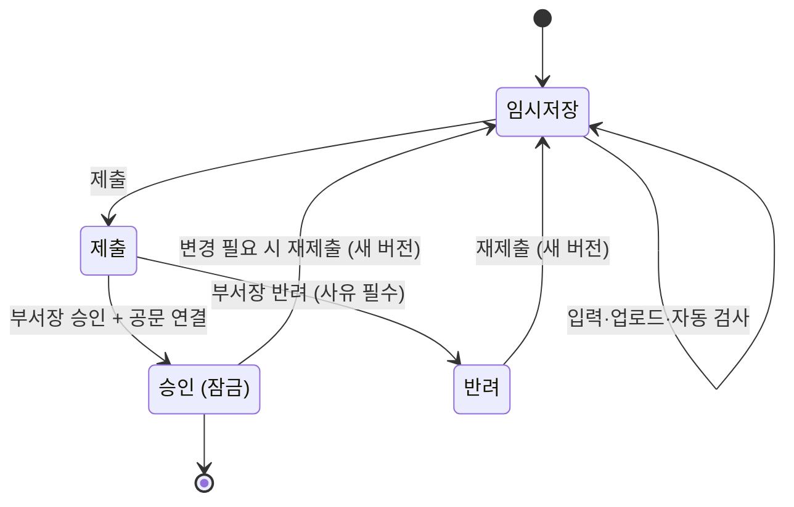

마감 현황판(FN-15)은 부서별로 `미제출` / `제출` / `승인` / `반려` / `지연`을 보여줍니다. `지연`은 마감일이 지나도 승인되지 않은 상태입니다.

---

## 10. 기술 스택

| 영역 | 스택 | 이유 |
| :--- | :--- | :--- |
| 프론트엔드 | React + TypeScript + MUI | 대용량 데이터 그리드, 타입 안정성, 접근성 컴포넌트 (NFR-14) |
| 모바일 | 반응형 웹 + PWA | 설치 없이 담당자 모바일 브라우저에서 전자출석 (FN-12, NFR-15) |
| 백엔드 | Python + Django REST Framework | 복잡한 도메인·룰 엔진, 객체 단위 권한 검사 (T1) |
| 데이터베이스 | PostgreSQL | 정확한 `NUMERIC` (T3), JSONB(양식 설정·규칙 스냅샷), 트랜잭션 |
| 엑셀 엔진 | pandas + openpyxl (xls는 xlrd) | 이종 엑셀 정규화, 원본 서식 보존 주입 (T2, NFR-15) |
| OCR | OpenCV + PaddleOCR | 기울기·잡음 보정, 한국어·숫자 인식, 온프레미스 (T4, NFR-08) |
| PDF | 서버 측 PDF 생성 | 출석 확인서·청구서 (FN-13) |
| 비동기 작업 | Celery + Redis + Celery Beat | 대량 검증·OCR·서식 생성, 마감 독촉 스케줄 |

---

## 11. 보안 및 데이터 관리

| 영역 | 규칙 | 근거 |
| :--- | :--- | :--- |
| 네트워크 | 행정망 단독 운영. 외부 인터넷·SaaS·CDN·외부 메일 미사용, 알림은 웹 알림 | NFR-05 |
| 접근 제어 | 역할·사업·부서 범위를 **서버에서** 검사, 범위 밖 요청은 403 | NFR-09, T1 |
| 고유식별정보 | 주민번호·계좌번호는 AES-256 암호문 + 동일인 식별 해시로 분리 저장. 키는 코드와 분리 | NFR-06 |
| 화면 표시 | 기본 마스킹 `880101-1******`. 복호화 조회는 권한자만, 사유·일시 기록 | NFR-06 |
| 전송·인증 | 전 구간 TLS 1.2 이상, 비밀번호 단방향 해시, 5회 실패 잠금, 30분 무활동 세션 종료 | NFR-06, NFR-07 |
| 파일 다운로드 | 주민번호 포함 파일은 출력 권한자만, 파일 암호 설정, 이력 기록 | NFR-07 |
| 원본 파일 | 타 사업 근로자가 섞인 공단 원본·스캔본은 비공개 스토리지에 격리 | NFR-08 |
| AI·OCR | 서버 내부에서만 처리, 외부 전송 금지 | NFR-08 |
| 감사 로그 | 오류 수정·수동 매칭·파일 생성·지급/신고 상태 변경 시 작업자·일시·전후 값·사유. 수정·삭제 불가 | NFR-10 |
| 무결성 | 업로드·대량 계산은 트랜잭션, 파일 해시로 재업로드 중복 방지, 제출본·청구서·서명본 버전 보존 | NFR-12 |
| 보존·파기 | 업무 필요 최소 항목만 수집, 보유기간 경과 시 파기. 감사 로그는 회계 증빙 보존 연한 | NFR-08, NFR-10 |
| 백업 | 일 1회 이상, RPO 24시간·RTO 4시간, 분기별 복구 훈련 | NFR-04 |
| 개발 | 실제 개인정보·업무 파일은 저장소에 올리지 않음. 개발·시연·테스트는 가상 데이터 | NFR-08 |

---

## 12. 기술 제약 T1~T4

| 코드 | 제약 | 대응 |
| :---: | :--- | :--- |
| **T1** | 사업·부서별 데이터 격리와 세부 권한 | 서버 측 RBAC, 객체 단위 권한 검사 |
| **T2** | 엑셀 파서는 수식을 계산하지 않음 | 캐시된 계산값을 믿지 않고 서버에서 재계산 |
| **T3** | 부동소수점 오차 | Decimal 연산 + DB `NUMERIC`, 반올림 규칙 설정화 |
| **T4** | OCR 판독 불확실성 | 성명·날짜·근무구분을 항목별로 대조, 신뢰도만으로 확정 금지, 미판독은 수동 보정 |

---

## 13. 전제 (가정)

이 문서는 **모든 기능이 구현된다는 전제**로 작성했습니다 (지도교수 방침). 아래 가정이 깨지면 해당 부분을 다시 설계합니다. 기능 명세서의 가정은 [FEATURES.md 6장](FEATURES.md#6-가정-및-확인-필요-사항)에 있습니다.

| # | 가정 | 영향 받는 부분 |
| :---: | :--- | :--- |
| A1 | FN-01 ~ FN-16 전 기능을 한 학기 안에 구현할 수 있다 | 전체, [로드맵](ROADMAP.md) |
| A2 | 약 60개 부서가 공통 포털에 직접 제출하고, 담당 공무원이 모바일로 전자출석을 입력할 수 있다 (현행 제약은 어렵다고 했으나 캡스톤에서는 가능으로 가정) | FN-09, FN-12 |
| A3 | 부서 엑셀·스캔 출석부·4대보험 고지 자료 **양식** 샘플을 확보한다. 실제 개인정보 서버에는 접근할 수 없으므로 데이터는 가상으로 만든다 | FN-02, FN-04, FN-06 |
| A4 | PaddleOCR이 행정 출석부의 인쇄 글자·숫자를 실무에 쓸 만큼 읽고, 온프레미스 서버에서 1장 60초 안에 처리된다 | FN-06, NFR-02 |
| A5 | 건강보험공단·EDI·일모아·인사랑의 업로드 규격(열 순서, 코드값)을 확보한다 | FN-07, FN-16 |
| A6 | 근로자 전자서명의 증빙 효력은 담당 부서 확인 전까지 보장되지 않으므로, 출력본 서명 후 스캔 업로드를 함께 지원한다 | FN-13 |
| A7 | NFR 수치(응답 시간, 가용률, 보존 기간)는 제안값이며 담당 부서와 협의해 확정한다 | NFR 전체 |
| A8 | 기술 스택은 [10장](#10-기술-스택) 구성으로 확정한다 | 전체 |
