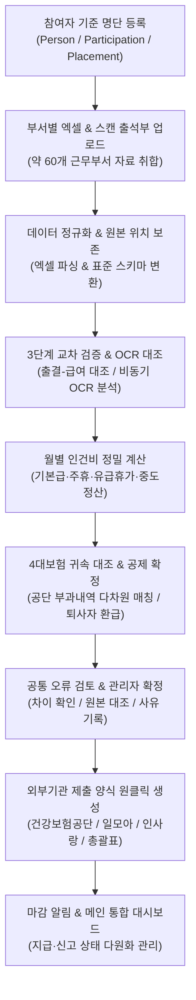
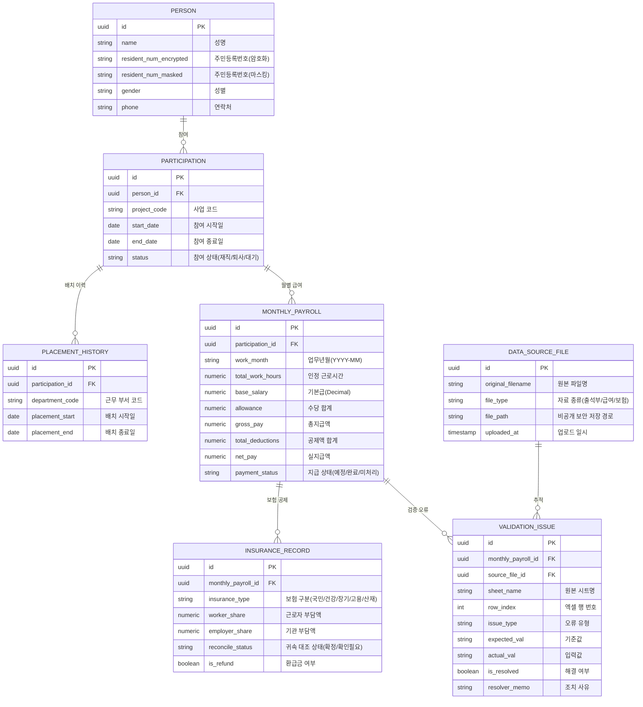

# 행정 구조대
> **부서별 공공일자리 참여자·출석·급여·4대보험 통합 및 교차 검증·제출서식 자동화 웹 플랫폼**

---

## 목차
1. [프로젝트 개요](#1-프로젝트-개요)
2. [배경 및 문제 정의](#2-배경-및-문제-정의)
3. [전체 업무 흐름](#3-전체-업무-흐름)
4. [8대 필수 기능 명세](#4-8대-필수-기능-명세)
5. [데이터 아키텍처 및 핵심 도메인 모델](#5-데이터-아키텍처-및-핵심-도메인-모델)
6. [기술 요구조건 및 추천 스택 검토](#6-기술-요구조건-및-추천-스택-검토)
7. [보안 및 데이터 관리 원칙](#7-보안-및-데이터-관리-원칙)
8. [단계별 개발 로드맵 및 검증 시나리오](#8-단계별-개발-로드맵-및-검증-시나리오)
9. [팀 구성 및 역할](#9-팀-구성-및-역할)
10. [Git 브랜치 및 커밋 규칙](#10-git-브랜치-및-커밋-규칙)
11. [PR 규칙 및 템플릿](#11-pr-규칙-및-템플릿)
12. [로컬 개발 환경 안내](#12-로컬-개발-환경-안내)

---

## 1. 프로젝트 개요

> **"부서별 공공일자리 참여자·출석·급여·4대보험 자료를 통합하고, 반복적인 대조·검증과 제출자료 작성을 자동화하는 행정업무 지원 웹 플랫폼"**

- **주요 사용 대상**: 지자체 **일자리창출과 내부 관리자** 및 **사업 담당자**
- **운영 환경 맥락**: 약 **60개 현장 근무 부서**는 기존 업무 관행대로 엑셀과 출석부를 취합하여 전달하며, 총괄 부서(일자리창출과) 내부 담당자가 이를 웹 플랫폼에 등록하여 **자동 교차 검증, 급여 산출, 4대보험 귀속 대조, 외부기관 보고서식 생성**을 원스톱으로 처리합니다.
- **문서 성격**: 본 프로젝트는 현재 기획 및 인터뷰 요구사항 분석을 마친 설계 단계이며, 제안된 데이터 구조와 아키텍처를 바탕으로 팀 기술 협의를 거쳐 최종 구현을 확정합니다.

---

## 2. 배경 및 문제 정의

지자체 및 공공기관의 공공일자리 사업은 매월 수백 명의 취약계층·청년·어르신 등이 참여하며, 다음과 같은 치명적인 행정 병목을 겪고 있습니다.

| 기존 행정 업무의 한계 | 본 플랫폼의 해결책 |
| :--- | :--- |
| **60여 개 부서의 제각각 엑셀 서식과 수기 취합**<br>열 순서, 날짜 표기, 셀 병합, 문자열 포맷이 달라 수기 복사·붙여넣기로 야근 발생 | **양식별 매핑 기반 엑셀 표준화 엔진**<br>비정형 열·헤더를 표준 스키마로 즉시 정규화하고 원본 행 번호 및 시트 메타데이터를 영구 보존하여 추적성 확보 |
| **복잡한 인건비 수작업 계산 및 오차**<br>조퇴, 결근, 유·무급 휴가, 중도 입·퇴사 정산 시 소수점 절사 및 수식 오류 발생 | **결정론적 정밀 계산 엔진**<br>고정밀 십진수 연산(Decimal, NUMERIC)을 통해 부동소수점 오차를 차단하고 항목별 산출 근거를 투명하게 보존 |
| **대규모 4대보험 통합 고지서 분리 곤란**<br>기관 전체 수천 명 고지서에서 일자리 참여자를 주민번호만으로 찾다가 동명이인·타 사업 귀속 오류 발생 | **다차원 보험 귀속 매칭 엔진**<br>주민번호 단독 매칭을 지양하고 사업장 기호, 귀속기간, 부서 배치이력을 결합 검증하며 퇴사자 과거 환급금까지 완벽 추적 |
| **스캔 출석부 육안 전수 검수 피로도**<br>현장에서 수기로 서명·체크된 종이 출석부와 엑셀 근무시간을 일일이 대조 | **지능형 출석부 대조 파이프라인 (OCR)**<br>이미지 왜곡·기울기 보정 및 한국어 행정 서식 특화 OCR로 엑셀 대조표를 생성하고 나란히 비교하며 불일치 하이라이트 제공 |
| **외부 연계 시스템별 상이한 제출 양식**<br>건강보험공단, 일모아, 인사랑 등 각기 다른 파일 규격으로 재작업 반복 | **원클릭 외부기관 제출 서식 자동 생성**<br>검증 완료된 단일 원천 데이터를 바탕으로 각 시스템별 필수 코드·열 규격에 맞춘 공식 엑셀 서식을 무인 생성 |

---

## 3. 전체 업무 흐름



---

## 4. 8대 필수 기능 명세

> 본 명세는 사용자 인터뷰 요구사항 및 `공공일자리_필수기능_정의서.pdf`를 기반으로 정의되었습니다.

### 01. 참여자 통합 등록·검색
- **목적**: 참여자를 사업·부서·담당자별로 조회하고, 부서 이동이나 중도 퇴사 이후에도 이전 근무 및 정산 내역을 완벽하게 추적.
- **주요 입력 및 결과**:
  - **입력**: 기준 명단, 사업명, 담당자, 배치 부서, 근무 시작·종료일.
  - **결과**: 이름, 식별 정보(마스킹), 성별, 사업, 부서, 근무월, 재직 상태별 다차원 검색 및 개인별 전생애 근무 이력.
- **구현 방식 (설계 제안)**:
  - 사람(`Person`), 사업 참여(`Participation`), 부서 배치 이력(`PlacementHistory`)을 물리 테이블로 정규화 분리.
  - 동일인의 다음 연도 재참여, 사업 간 이동, 부서 전보 이력을 각각 독립된 엔티티로 관리하여 과거 급여/보험 환급 데이터와의 연결성 보존.
  - REST API를 통해 화면과 서버 간 정규화된 데이터를 안정적으로 송수신.
- **완료 기준**:
  - 부서 이동 전후의 이력이 100% 보존되며, "특정 기준일 현재 재직자"와 "해당 월에 실제 근무한 참여자"가 각각 오차 없이 조회됨.

---

### 02. 엑셀 업로드·자동 취합
- **목적**: 약 60개 현장 부서에서 작성한 비정형 엑셀을 월별 단일 표준 데이터로 자동 취합하고 기준 명단과 실시간 대조.
- **주요 입력 및 결과**:
  - **입력**: 자료 종류(출석/급여), 대상 사업, 근무 부서, 업무년월 선택 후 파일 업로드.
  - **결과**: 표준 통합 목록, 누락·중복·포맷 오류 리포트, DB 반영 전 사전 미리보기.
- **구현 방식 (설계 제안)**:
  - 엑셀 파서를 통해 시트와 셀을 로우 레벨에서 파싱하고, 컬럼 정규화, 날짜 포맷(`YYYY-MM-DD`), 금액 변환 수행.
  - 역추적성을 위해 업로드 시점의 **원본 파일명, 시트명, 엑셀 행 번호**를 메타데이터로 영구 보존.
- **핵심 처리 원칙 (지킬 기준)**:
  - 식별자(주민번호, 사번 등)는 앞자리 0 누락 방지를 위해 무조건 **문자열**로 파싱.
  - 문서 상단 안내 문구, 하단 합계/소계 행을 자동 필터링하여 실제 참여자 행과 엄격히 분리.
  - **[T2 원칙]**: 엑셀 파서 라이브러리(예: openpyxl 등)는 엑셀 수식을 직접 평가하지 않으므로, 엑셀 캐시에 저장된 계산값을 검산의 절대 정답으로 신뢰하지 않고 서버 계산 엔진으로 재검증.
- **완료 기준**:
  - 수작업 취합 정답과 시스템 취합 결과가 100% 일치하며, 중복 업로드 시 멱등성이 보장되어 중복 행이 생성되지 않음.

---

### 03. 월별 인건비 계산·전체 금액 집계
- **목적**: 근무시간, 휴가, 조퇴, 중도 입·퇴사 기준을 종합 반영하여 개인별 급여와 부서·사업·월별 총괄 금액을 한 치의 오차 없이 산출.
- **계산 공식 및 원칙**:
  $$\text{총 지급액} = \sum (\text{승인된 법정 지급 항목 (기본급, 주휴수당, 유급휴가수당 등)})$$
  $$\text{실지급액} = \text{총 지급액} - \text{확인된 근로자 4대보험 공제액}$$
  - *기관 부담 4대보험료와 근로자 공제액은 회계 구분을 위해 완전 별도 관리.*
- **구현 흐름**:
  1. 실제 지급 규정 및 사례를 분석하여 정상 근무 총 지급액 계산.
  2. 조퇴(분 단위 공제), 유·무급 휴가, 중도 입퇴사 일할 계산 조건 분기 처리.
  3. 휴가 발생·사용·잔여·정산 일수를 별도 원장으로 기록하여 증빙 근거 보존.
  4. 4대보험 검증 완료 후 근로자 공제액을 차감하여 최종 실지급액 확정.
  5. 개인별 합산 및 지급 상태(`지급 예정` -> `지급 완료` -> `미처리`) 단계적 갱신.
- **기술 제약**:
  - 금융/회계 부동소수점 오차 방지를 위해 십진수 고정밀 계산형(Decimal) 및 데이터베이스의 정확한 숫자형(NUMERIC) 필수 사용 **[T3]**.
- **완료 기준**:
  - 과거 수작업 지급 완료 사례의 모든 케이스(정상/조퇴/휴가/중도퇴사/미사용휴가정산)와 1원 단위까지 일치.

---

### 04. 4대보험 부과·납부·환급 관리
- **목적**: 국민건강보험공단 등에서 발행한 지자체 전체 대규모 고지 자료에서 공공일자리 참여자 내역만 정확히 추출하고 부과·납부·환급 이력을 영구 관리.
- **핵심 분리 기준**:
  - **동일인의 타 사업 근무 분리**: 과거 타 공공근로 참여 이력과 현재 참여 사업 구분.
  - **부과월 vs 귀속기간 분리**: 고지서 청구 월과 실제 근무 귀속 월의 불일치 정산.
  - **퇴사자 과거 환급금 추적**: 이미 퇴사한 인원에 대한 과오납 환급금을 놓치지 않고 미환급금 원장에 매핑.
- **자동 연결 한계 대응 및 원칙**:
  - **주민등록번호 단독 매칭 절대 금지**: 사업장 기호, 귀속 기간, 부서 배치 이력을 다차원으로 교차 대조.
  - 근거가 확실한 행만 자동 연결하고, 불명확한 행은 원본 정보 및 유사 후보 목록과 함께 **'확인 필요' 플래그** 지정.
- **완료 기준**:
  - 공단 원본 데이터에서 해당 사업 / 타 사업 / 확인 필요 건이 완벽히 분류되며, 퇴사자의 과거 환급 내역이 누락 없이 조회됨.

---

### 05. 제출자료 누락·오류 검증
- **목적**: 엑셀 및 시스템 간 데이터 불일치를 사전에 포착하여 행정사고 및 감사 지적을 원천 예방.
- **주요 검사 대상**:
  - 필수 입력값 누락, 기준 명단 미등록자(유령 근로자), 중복 지급 데이터.
  - 참여 승인 기간 외에 입력된 비정상 근무일/시간.
  - 현장 제출액과 서버 재계산액 간의 오차.
  - 4대보험 귀속 불명확 및 법정 연령별 공제 제외자(만 60세 국민연금, 만 65세 고용보험 등) 착오 공제.
- **구현 방식**:
  - 비즈니스 검증 룰셋을 모듈화하고, 오류 발생 시 `ValidationIssue` 공통 테이블에 대상자, 오류 항목, 검사 사유, 입력값, 기준값, 차이 금액, 원본 위치(파일명/시트/행)를 기록.
  - 담당자가 웹에서 오류 항목을 클릭하면 원본 위치를 즉시 확인하고 소명 사유 입력 또는 수정 후 **즉시 재검사** 실행.
- **완료 기준**:
  - 수정 전/후 감사 로그(수정자, 일시, 수정 사유)가 저장되고 수정 즉시 통계 및 총괄 집계가 갱신됨.

---

### 06. 스캔 출석부·인건비 엑셀 자동 비교
- **목적**: 수기로 서명 또는 체크된 종이 출석부 스캔본(PDF, 이미지)과 엑셀 근무시간을 광학 문자 인식(OCR)으로 교차 대조하여 육안 대조 업무를 80% 이상 단축.
- **처리 파이프라인**:
  ```
  스캔 출석부 업로드 -> 이미지 전처리(기울기 보정·노이즈 제거·표 외곽선 검출)
  -> 비동기 작업 큐 위임 -> 한국어 행정 서식 OCR 모델 글자·숫자 인식
  -> 참여자·날짜·근무시간 매핑 -> 엑셀 데이터와 일치/불일치/미판독 판정
  ```
- **검토 인터페이스**:
  - 좌측 원본 스캔 이미지 영역과 우측 엑셀 추출 데이터 테이블을 나란히 배치.
  - 불일치 항목 및 신뢰도 점수 미달 항목은 붉은색 테두리로 강조 표시하며 클릭 시 해당 좌표로 자동 스크롤.
- **초반 검증 원칙**:
  - 인쇄 활자, 숫자, 수기 체크 표시, 서명/손글씨를 분리하여 검증 **[T4]**. OCR 신뢰도 수치만으로 자동 확정하지 않으며 최종 검토는 담당자가 승인.
- **완료 기준**:
  - 비동기 처리 상태(대기/진행/완료/실패)가 실시간 반영되며, 미판독 및 불일치 항목을 검토 화면에서 직접 수정 가능.

---

### 07. 외부기관 제출 양식 자동 생성
- **대상 결과물**:
  1. 국민건강보험공단 EDI 신고 파일
  2. 4대보험 취득·상실 신고 엑셀 자료
  3. 행정안전부 **일모아** 및 지방행정공제회 **인사랑** 일괄 업로드 규격 서식
  4. 부서별·사업별 인건비 지출 결의 첨부 엑셀
  5. 월별 인건비 총괄 집계표
- **구현 방식**:
  - 외부 기관별 공식 템플릿의 열 순서, 셀 서식, 코드값(사업장 코드, 직종 코드 등), 날짜 구분 기호 규칙을 매핑 엔진에 사전 등록.
  - 서식 템플릿 바이너리에 검증된 원천 데이터를 직주입하고 생성 파일에 사용된 데이터 기준 시점을 워터마크/메타데이터로 보존.
- **완료 기준**:
  - 생성된 엑셀 파일이 외부 기관 시스템 일괄 업로드 테스트를 무에러로 통과하고 인쇄 영역/스타일이 깨지지 않음.

---

### 08. 담당 업무·마감 알림과 메인 현황
- **주요 모니터링 지표**:
  - 선발 인원 / 현재 재직 인원 / 중도 퇴사 인원 통계.
  - 사업별·부서별 배정 예산 대비 집행률 및 잔여 인건비.
  - 급여 지급 예정액, 지급 완료액, 미처리 인원 수.
  - 4대보험 부과액, 실납부액, 과오납 환급 대상 및 미지급액.
  - 외부 취득·상실 신고 기한 임박 목록.
- **업무 상태 분리 원칙**:
  > **[중요]** 아래 상태들은 각기 독립적인 라이프사이클을 가지며 상호 종속되지 않습니다.
  - `계산 완료` $\neq$ `서식 생성 완료` $\neq$ `급여 지급 완료` $\neq$ `보험 납부 완료` $\neq$ `외부 신고 완료`
  - 서식 파일을 다운로드했다고 해서 실제 시스템 신고나 지급이 완료된 것으로 자동 전환하지 않음.
- **알림 엔진**:
  - 법정 신고 기한(예: 익월 15일까지 고용·산재 신고 등) 및 기관 지침 마감일을 기준으로 D-7, D-3, D-Day 웹 인앱 알림 발송.

---

## 5. 데이터 아키텍처 및 핵심 도메인 모델

데이터 간 결합도를 낮추고 이력 추적성을 극대화하기 위해 사람과 업무 이력을 5개 핵심 도메인으로 분리 설계합니다.



---

## 6. 기술 요구조건 및 추천 스택 검토

> **안내**: 현재 본 프로젝트의 기술 스택은 팀 논의 및 요구사항 분석 단계에 있으며 최종 확정 전입니다. 아래 내용은 `공공일자리_필수기능_정의서.pdf`에서 제시된 **필수 기술 요구조건**과 이를 달성하기 위한 **추천 제안 스택(후보군)** 입니다. 팀원 간 기술 검토 회의를 거쳐 최종 기술 스택을 확정할 예정입니다.

### 핵심 기술 요구조건
1. **금융·급여 정밀 연산**: 부동소수점 오차 없는 원 단위 십진수 연산(Decimal) 및 DB의 정확한 숫자형(NUMERIC) 지원 필수.
2. **이종 엑셀 파싱 및 서식 제어**: 60여 개 부서의 다양한 엑셀 서식 정규화 및 원본 서식/결재란을 유지하는 엑셀 바이너리 주입 기능.
3. **대용량 비동기 분리**: 스캔 출석부 OCR 이미지 분석 및 대규모 서식 생성 작업의 백그라운드 작업 큐 처리.
4. **한글 행정 서식 특화 OCR**: 공공기관 표 서식의 외곽선 검출, 한글 및 숫자 판독 정확도 확보.
5. **세분화된 접근 권한 제어(RBAC)**: 일자리창출과 관리자 vs 개별 사업 담당자 간 사업별 데이터 격리 및 고유식별정보 암호화.

### 추천 제안 스택 및 후보군 비교

| 영역 | 정의서 추천 제안 스택 | 요구 기능 및 추천 사유 | 대안 후보군 |
| :--- | :--- | :--- | :--- |
| **프론트엔드** | **React + TypeScript + MUI** | • 대용량 출석·급여 데이터 그리드 렌더링 최적화<br>• 정적 타입 시스템을 통한 스키마 런타임 오류 방지 | Next.js, Vue 3, Svelte |
| **백엔드** | **Python + Django REST Framework** | • 복잡한 공공일자리 비즈니스 도메인 및 룰 엔진 모델링 용이<br>• 강력한 세션/토큰 인증 및 사업별 세부 접근 권한 검사 구현 **[T1]** | FastAPI, Spring Boot, NestJS |
| **데이터베이스** | **PostgreSQL** | • 원 단위 금융·급여 정밀 계산을 지원하는 정확한 `NUMERIC` 지원 **[T3]**<br>• JSONB 메타데이터 지원 및 복잡한 이력 트랜잭션 무결성 보장 | MySQL 8.0, MariaDB |
| **엑셀 엔진** | **pandas + openpyxl** | • `openpyxl`: 셀 스타일, 결재란, 서식을 보존하는 원본 템플릿 직주입 생성<br>• `pandas`: 60개 부서의 이종 엑셀 데이터 고속 일괄 정규화<br>• 수식 실행 불가 한계 대응 자체 검증 탑재 **[T2]** | Apache POI, ExcelJS |
| **OCR 엔진** | **OpenCV + PaddleOCR** | • `OpenCV`: 이미지 왜곡 보정, 노이즈 필터링, 표 테이블 외곽선 분할<br>• `PaddleOCR`: 한글 행정 서식 특화 경량 모델 (`korean_PP-OCRv5_mobile_rec`) **[T4]** | Tesseract OCR, Cloud OCR |
| **비동기 작업** | **Celery + Redis** | • 스캔 출석부 OCR 및 대규모 엑셀 빌드 작업의 비동기 백그라운드 위임<br>• 작업 진행률 실시간 트래킹 및 장애 시 재시도 보장 | BullMQ, Spring Batch |

---

## 7. 보안 및 데이터 관리 원칙

1. **역할 기반 접근 제어(RBAC) [T1]**
   - **총괄 관리자(일자리창출과)**: 전체 공공일자리 사업 열람, 권한 부여, 감사 로그 조회, 마감 통제.
   - **개별 사업 담당자**: 본인에게 배정된 단일 사업 범위 내에서만 등록·수정·다운로드 가능 (타 사업 데이터 접근 시 서버 단에서 403 Forbidden 강제 차단).
2. **개인정보 보호 및 고유식별정보 암호화**
   - 주민등록번호는 단방향 해시(동일인 식별용)와 **양방향 AES-256 암호화**로 분리 저장하며, 암호화 키는 소스 코드 및 파일 시스템과 완전 격리된 환경 변수로 관리.
   - 화면 출력 시 생년월일 및 성별을 제외한 뒷자리는 마스킹(`880101-1******`) 필수 처리.
   - 타 사업 근로자가 혼재된 공단 4대보험 원본 파일은 비공개 스토리지에 격리 보관하며 열람 권한을 제한.
3. **원자적 트랜잭션 및 감사 로그**
   - 엑셀 업로드 및 대량 계산 처리는 데이터베이스 트랜잭션으로 격리하여 오류 발생 시 롤백.
   - 모든 수정·검증 확정 내역에 대해 **수정자 ID, 일시, 변경 전/후 값, 사유**를 불변 원장으로 영구 기록.

---

## 8. 단계별 개발 로드맵 및 검증 시나리오

### 단계별 구현 로드맵

| 단계 | 구현 내용 | 다음 단계 진입 기준 |
| :---: | :--- | :--- |
| **Phase 0** | 실제 샘플 파일 확보, 4대보험 원본 분석, 팀 기술 스택 확정 및 OCR 프로토타입 실험 | 실제 부과 자료의 구분 정보, 최종 기술 스택 및 OCR 인식 가능 필드 확정 |
| **Phase 1** | RBAC 권한 체계, 사업·부서·참여자·배치이력 마스터 CRUD 구축 | 사업별 데이터 격리 검증 및 날짜별 참여 이력 완벽 조회 |
| **Phase 2** | 엑셀 파서 구축, 60개 부서 자료 취합 엔진, 기본 스키마 오류 검사 | 수작업 취합 정답과 시스템 취합 결과 100% 일치 |
| **Phase 3** | 월별 인건비 정밀 계산 모듈 (총지급액, 휴가, 중도퇴사 정산) | 지자체 지급 승인 사례 데이터와 항목별 금액 100% 일치 |
| **Phase 4** | 4대보험 다차원 귀속 매칭, 근로자 공제액 확정, 퇴사자 환급 추적 | 실지급액 확정 및 공단 고지-급여 대조율 검증 |
| **Phase 5** | 공통 오류 검토 화면, 스캔 출석부 OCR-엑셀 비교 뷰 | 담당자가 웹에서 오류 확인·수정 후 즉시 재검사 가능 |
| **Phase 6** | 건강보험·일모아·인사랑 외부기관 제출 서식 빌더, 마감 대시보드 | 실제 대상 시스템 업로드 통과 및 미처리 업무 알림 검증 |
| **Phase 7** | 한 달 전체 업무 사이클 E2E 통합 테스트 및 스테이징 운영 환경 검증 | 참여자 등록부터 외부 서식 다운로드까지 무중단 흐름 완성 |

### 대표 7대 검증 시나리오

1. **정상 근무 및 중도 입·퇴사자 복합 케이스**: 일할 계산, 유급휴가, 미사용 휴가 정산금이 승인된 기준과 정확히 일치하는가?
2. **월중 부서 이동 케이스**: 월 중간에 부서를 이동한 참여자의 근무시간과 부서별 예산 집계가 중복이나 누락 없이 정확한가?
3. **4대보험 동일인 복수 내역 케이스**: 한 사람이 여러 사업장에 등재되어 있거나 과거 환급 내역이 포함되어 있을 때 정상 복수 행을 보존하는가?
4. **퇴사자의 과거 환급금 케이스**: 현재 재직자가 아니더라도 과거 사업 참여자에게 발생한 보험 환급금이 미환급 원장에 올바르게 매핑되는가?
5. **수식 미반영 및 재업로드 케이스**: 수식이 깨지거나 빈 셀이 존재하는 엑셀을 업로드했을 때 오류 위치를 지목하고 중복 반영을 방지하는가?
6. **흐린 스캔본·체크 표시·동명이인 케이스**: OCR 판독 신뢰도가 낮은 경우 시스템이 임의 확정하지 않고 관리자 확인 대상으로 안전하게 분류하는가?
7. **비인가 접근 및 완료 상태 변조 차단**: 타 사업 담당자가 URL을 통해 접근할 때 차단되며, 파일 다운로드 시 '지급 완료'로 자동 오인 처리되지 않는가?

---

## 9. 팀 구성 및 역할

| Name | Role | Responsibilities |
| :--- | :---: | :--- |
| **이규빈** | **PM** | • 프로젝트 총괄, WBS 일정 관리 및 요구사항 정의<br>• 행정 업무 프로세스 분석 및 비즈니스 검증 규칙 명세<br>• 지자체/기관 요구사항 인터뷰 및 최종 발표 총괄 |
| **박희동** | **UI/UX** | • 복잡한 대용량 출석·급여 대조표의 직관적인 데이터 그리드 설계<br>• 오류 하이라이트 및 템플릿 매핑 마법사 화면 설계<br>• 디자인 시스템 구축 및 컴포넌트 표준화 |
| **황규빈** | **Frontend** | • 통합 대시보드 및 검증 결과 비교/재계산 화면 구현<br>• 대용량 데이터 테이블 렌더링 최적화 및 상태 관리<br>• 사용자 인터랙션 및 반응형 웹 레이아웃 구축 |
| **제성준** | **Frontend** | • 비정형 엑셀 업로드 UI 및 템플릿 매핑 마법사 인터페이스 구현<br>• HWPX / XLSX 서식 원클릭 다운로드 연동<br>• 프론트엔드 API 통신 모듈 및 예외 처리 화면 개발 |
| **김정운** | **Backend** | • 참여자·출석·급여 통합 도메인 설계 및 메인 REST API 구축<br>• 출석·급여·4대보험 교차 검증 룰 엔진 개발<br>• HWPX/XLSX XML 문서 자동화 엔진 및 RAG 파이프라인 연동 |
| **김준승** | **QA** | • 교차 검증 룰 엔진 엣지 케이스 및 데이터 정합성 검증<br>• HWPX / XLSX 서식 생성 파이프라인 무결성 및 인쇄 품질 테스트<br>• End-to-End 시나리오 기반 테스트 및 시스템 성능/안정성 검증 |
| **황원경** | **Documentation** | • 기술 명세서, 시스템 아키텍처 다이어그램 및 API 문서화<br>• 지자체별 공공일자리 사업 지침 및 법정 규정 리서치<br>• 기관별 원본 제출 양식 분석 및 템플릿 매핑 정의서 작성 |

---

## 10. Git 브랜치 및 커밋 규칙

원활한 협업과 변경 이력의 투명성을 위해 엄격한 Git 워크플로우를 준수합니다.

### 브랜치 전략
- 기본 베이스 브랜치는 `main` (운영 배포)과 `develop` (개발 통합)을 기준으로 합니다.
- 모든 기능 개발과 작업은 `develop` 브랜치에서 분기하여 작업 후 PR을 통해 병합합니다.
- **브랜치 네이밍 형식**: `<prefix>/<기능 또는 작업명>` (소문자 및 하이픈 `-` 사용)

| Prefix | 사용 목적 | 예시 |
| :--- | :--- | :--- |
| `feat` | 새로운 기능 개발 | `feat/ocr-pipeline`, `feat/payroll-calculator`, `feat/excel-ingestion` |
| `fix` | 버그 및 결함 수정 | `fix/decimal-rounding-error`, `fix/insurance-matching-null` |
| `docs` | 문서 작성 및 수정 | `docs/readme-specification`, `docs/api-guide` |
| `refactor` | 코드 리팩토링 (기능 변경 없음) | `refactor/clean-payroll-service`, `refactor/ocr-worker` |
| `test` | 테스트 코드 작성 및 검증 | `test/payroll-edge-cases`, `test/e2e-scenarios` |
| `chore` | 빌드, 패키지 매니저, 환경 설정 | `chore/update-dependencies`, `chore/docker-compose` |

---

### 커밋 메시지 규칙

커밋 메시지는 **Conventional Commits** 표준을 따르며, **제목(무엇을)**, **변경 이유(왜)**, **변경 내용(어떻게)**을 본문에 명확히 서술해야 합니다.

#### 1. 기본 구조
```gitcommit
<Type>: <작업 내용 요약 (50자 이내, 명령조/명사형)>

## 변경 이유
- 어떤 문제를 해결하고자 했는지, 어떤 기획/법정 요구사항에 의한 것인지 서술합니다.
- 변경이 필요했던 배경과 맥락을 작성합니다.

## 변경 내용
- 문제 해결을 위해 구체적으로 어떤 로직과 컴포넌트를 어떻게 수정했는지 기술합니다.
- 부수 효과나 데이터 마이그레이션이 있다면 명시합니다.

Resolves: #이슈번호 (선택사항)
```

#### 2. 커밋 타입
- `feat`: 새로운 기능 추가 (예: OCR 파이프라인 추가, 4대보험 귀속 매칭 추가)
- `fix`: 버그 및 오류 수정 (예: 일할 계산 시 주휴수당 누락 버그 수정)
- `docs`: 문서 수정 및 추가 (예: README 명세서 최신화, API 문서 작성)
- `style`: 코드 포맷팅, 세미콜론 누락, 들여쓰기 수정 (로직 변경 없음)
- `refactor`: 프로덕션 코드 리팩토링 (기능 추가 또는 버그 수정 없음)
- `test`: 테스트 코드 추가, 단위 테스트 보강, Fixture 수정
- `chore`: 빌드 업무 수정, 패키지 설치, `.gitignore` 수정 등 기타 작업

#### 3. 모범 커밋 예시
```gitcommit
feat: 4대보험 고지 자료 다차원 귀속 매칭 로직 구현

## 변경 이유
- 공공일자리_필수기능_정의서 04번 요구사항에 따라, 주민번호 단독 매칭 시 발생하는 동명이인 및 타 사업 참여자의 과오납 문제를 방지하기 위함.
- 퇴사자의 과거 환급금이 현재 재직 명단에서 누락되어 정산되지 않는 행정 오류를 차단해야 함.

## 변경 내용
- InsuranceMatcher 서비스 클래스 신설: 주민번호 외에 사업장 기호, 귀속 년월, 부서 배치 이력(PlacementHistory)을 3단계로 교차 검증하도록 구현.
- 매칭 신뢰도가 불확실한 경우 자동 확정하지 않고 VALIDATION_ISSUE 테이블에 CONFIRM_REQUIRED 플래그로 저장하도록 예외 분기 추가.
- 퇴사자 과거 환급 건은 is_refund=True 메타데이터를 유지하여 미지급 목록에서 별도 추적 가능하도록 처리.

Resolves: #42
```

#### 4. 피해야 할 나쁜 예시
- [지양] `fix: 급여 수정` (무엇을, 왜, 어떻게 바꿨는지 전혀 알 수 없음)
- [지양] `feat: 기능 추가함` (추적 불가능한 커밋)
- [지양] `update: ocr.py` (변경 이유와 구현 방식 누락)

---

## 11. PR 규칙 및 템플릿

### PR 제목 규칙
`[<Type>] <PR 작업 요약>` 형태로 작성합니다.
- 예시: `[Feat] 출석부 이미지 텍스트 추출 및 비동기 작업 처리 구현`
- 예시: `[Fix] 만 65세 이상 참여자 고용보험 실업급여 요율 공제 예외 처리`
- 예시: `[Docs] 공공일자리 필수기능 정의서 기반 README 전면 보강`

---

### PR 본문 템플릿

> 모든 레포지토리에서 PR 생성 시 [PULL_REQUEST_TEMPLATE.md](https://github.com/YC-CapstoneDesign-5/.github/blob/main/.github/PULL_REQUEST_TEMPLATE.md)가 자동으로 채워집니다. 이슈 템플릿과 협업 가이드는 [CONTRIBUTING.md](https://github.com/YC-CapstoneDesign-5/.github/blob/main/CONTRIBUTING.md)를 참고하세요.

```markdown
## 개요
- 작업하신 브랜치: `feat/payroll-calculator` -> `develop`
- 관련 이슈 번호: Resolves #12

---

## 변경 이유
- 무엇을 해결하기 위한 작업인지, 어떤 기획/비즈니스 요구사항을 반영한 것인지 명확히 적어주세요.

---

## 주요 작업 내용
- [ ] 작업 내용 1: 핵심 구현 사항 기술
- [ ] 작업 내용 2: 로직 변경 및 DB 모델 수정 사항
- [ ] 작업 내용 3: 예외 처리 및 에러 핸들링

---

## 검증 내역 및 테스트 결과
- [ ] 정상 동작 확인 스크린샷 또는 테스트 로그 첨부
- [ ] 테스트 케이스 수행 결과: 단위 테스트 통과 여부
- [ ] 7대 대표 검증 시나리오 중 해당 시나리오 통과 여부 확인

---

## 셀프 체크리스트
- [ ] 커밋 메시지가 변경 이유와 변경 내용을 포함하여 규격에 맞게 작성되었는가?
- [ ] 불필요한 콘솔 로그, 임시 주석, 디버깅 코드를 제거했는가?
- [ ] 금액 및 수량 계산에 고정밀 십진수 연산(Decimal, NUMERIC)을 정확히 사용했는가?
- [ ] 개인정보(주민등록번호 등)가 암호화/마스킹 처리되었는가?
```

---

### 코드 리뷰 및 머지 정책
1. **최소 1인 이상의 승인**: PR은 최소 1명 이상의 동료 개발자 코드 리뷰와 승인을 받아야 머지할 수 있습니다.
2. **CI 빌드 및 테스트 통과 필수**: 정적 분석/린트 검사와 단위 테스트가 모두 성공해야 합니다.
3. **Squash and Merge 권장**: 기능 브랜치의 자잘한 작업 커밋들을 깔끔하게 단일 커밋으로 합쳐서 `develop`의 히스토리를 정돈합니다.
4. **브랜치 삭제**: 머지가 완료된 기능 브랜치는 즉시 삭제하여 브랜치 목록을 청결하게 유지합니다.

---

## 12. 로컬 개발 환경 안내

> **안내**: 본 프로젝트의 기술 스택은 팀 논의를 거쳐 최종 확정될 예정이며, 스택 확정 후 각 파트별 구체적인 로컬 실행 매뉴얼이 공지됩니다. 아래는 `공공일자리_필수기능_정의서` 추천 스택 기준의 환경 구성 예시입니다.

### 1. 요구 환경 예시
- Node.js 18+ 및 패키지 매니저(npm, yarn, pnpm)
- Python 3.11+ (또는 확정 백엔드 런타임)
- 관계형 데이터베이스: PostgreSQL 16+ (또는 MySQL 8.0+)
- 인메모리 큐/캐시: Redis (비동기 OCR 및 대용량 배치용)

### 2. 백엔드 세팅 예시
```bash
# 가상환경 생성 및 활성화
python3 -m venv venv
source venv/bin/activate

# 의존성 패키지 설치
pip install -r requirements.txt

# 데이터베이스 마이그레이션
python manage.py migrate

# 개발 서버 실행
python manage.py runserver
```

### 3. 프론트엔드 세팅 예시
```bash
cd frontend
npm install
npm run start
```

### 4. 비동기 작업 워커 실행 예시
```bash
celery -A config worker --loglevel=info
```
