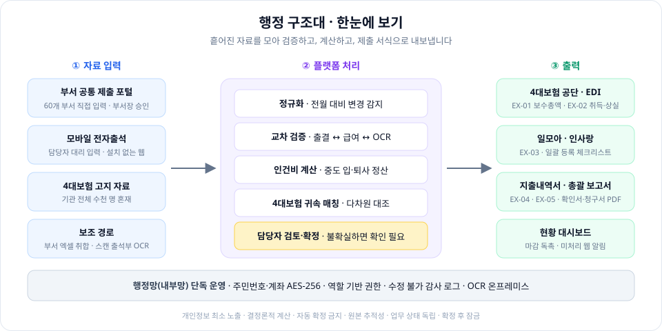

# 행정 구조대
> **공공일자리 참여자·출석·급여·4대보험 자료를 모아 교차 검증하고, 기관별 제출 양식까지 자동으로 만드는 행정업무 지원 웹 플랫폼**

## 왜 만드나
지자체 일자리창출과는 매달 약 60개 부서가 제각각 서식으로 보내는 출석·인건비 자료를 손으로 취합하고, 인건비를 계산하고, 수천 명이 섞인 4대보험 고지서에서 참여자분을 골라냅니다. 이 일에 **월 약 5일**이 걸립니다. 부서가 공통 포털에 직접 제출하고 담당자가 모바일로 출결을 입력하게 바꿔, 이 일을 **월 1일 이내**의 **검증 가능한 자동화**로 줄이는 것이 목표입니다.

## 핵심 기능 (FN-01 ~ FN-08)
| ID | 기능 | 한 줄 요약 |
| :---: | :--- | :--- |
| FN-01 | 참여자 통합 등록·검색 | 부서 이동·재참여·퇴사 후에도 근무·정산 이력 추적 |
| FN-02 | 부서별 엑셀 자동 취합 | 포털 제출이 어려운 부서의 엑셀을 표준 데이터로, 원본 행 위치 보존 |
| FN-03 | 월별 인건비 계산·집계 | 엑셀 수식이 아닌 서버 Decimal 계산, 기관 부담금 분리 |
| FN-04 | 4대보험 귀속·납부·환급 | 주민번호 단독이 아닌 다차원 매칭, 퇴사자 환급 추적 |
| FN-05 | 제출자료 누락·오류 검증 | 누락·중복·금액 차이를 원본 위치와 함께 표시, 즉시 재검사 |
| FN-06 | 스캔 출석부·엑셀 비교 | OpenCV·PaddleOCR로 인식해 엑셀과 1:1 대조 |
| FN-07 | 기관별 제출 양식 Export | 건강보험공단·EDI·일모아·인사랑·내부 보고 5종 |
| FN-08 | 담당 업무·마감 알림 | 계산·파일·지급·납부·신고 상태 분리, 미처리 드릴다운 |

## 확장 기능 (FN-09 ~ FN-16)
| ID | 기능 | 한 줄 요약 |
| :---: | :--- | :--- |
| FN-09 | 부서 공통 제출 포털 | 60개 부서가 직접 입력·업로드, 입력 즉시 정규화, 버전 관리 |
| FN-10 | 부서장 승인·공문 연계 | 승인해야 확정, 반려 사유 필수, 확정 후 잠금 |
| FN-11 | 전월 대비 변경 항목 표시 | 계좌·근무시간·단가 변경 하이라이트, 계좌 변경 시 지급 잠금 |
| FN-12 | 담당자 모바일 출결 입력 | 설치 없는 모바일 웹, 담당자 대리 입력, 3터치 |
| FN-13 | 월말 확인서·청구서 서명 | PDF 자동 생성, 전자서명 또는 스캔, 금액 변경 시 재서명 |
| FN-14 | 중도 입·퇴사 자동 정산 | 일할 근무급·주휴·미사용 연차, 상실 신고 예상 보수액 |
| FN-15 | 제출 독촉·마감 관리 | 24일 요청 → 29일 마감 → 30일 독촉 → 1일 지급 |
| FN-16 | 일모아·인사랑 일괄 등록 지원 | 일괄 등록 파일 + 수기 입력 체크리스트 |

품질 기준은 비기능 요구사항 18개(NFR-01 ~ NFR-18)로 정했습니다. 행정망 단독 운영, 민감정보 암호화, 역할 기반 권한, 마감기 성능이 포함됩니다.

## 문서
| 문서 | 내용 |
| :--- | :--- |
| [아키텍처](https://github.com/YC-CapstoneDesign-5/.github/blob/main/docs/ARCHITECTURE.md) | 설계 원칙, 역할·권한, 시스템 구성도, 파이프라인, 데이터 모델, 보안 |
| [기능 명세](https://github.com/YC-CapstoneDesign-5/.github/blob/main/docs/FEATURES.md) | FN-01~16, Export 양식 EX-01~05, 비기능 요구사항 NFR-01~18 |
| [로드맵](https://github.com/YC-CapstoneDesign-5/.github/blob/main/docs/ROADMAP.md) | 단계별 구현 계획과 검증 시나리오 |
| [협업 가이드](https://github.com/YC-CapstoneDesign-5/.github/blob/main/CONTRIBUTING.md) | 브랜치·커밋·PR 규칙, 로컬 개발 환경 |

## 레포지토리
| 레포 | 설명 |
| :--- | :--- |
| [Front](https://github.com/YC-CapstoneDesign-5/Front) | 웹 프론트엔드 (PC + 모바일 전자출석 PWA) |
| [Back](https://github.com/YC-CapstoneDesign-5/Back) | API 서버·검증/계산 엔진·비동기 워커(OCR·서식 생성) |

## 팀
| 이름 | 역할 | 주요 담당 |
| :--- | :--- | :--- |
| **이규빈** | **PM** | 프로젝트 총괄, WBS 일정 관리 및 요구사항 정의 |
| **박희동** | **UI/UX** | 복잡한 대용량 출석·급여 대조표의 직관적인 데이터 그리드 설계 |
| **황규빈** | **Frontend** | 통합 대시보드 및 검증 결과 비교/재계산 화면 구현 |
| **제성준** | **Frontend** | 비정형 엑셀 업로드 UI 및 템플릿 매핑 마법사 인터페이스 구현 |
| **김정운** | **Backend** | 참여자·출석·급여 통합 도메인 설계 및 메인 REST API 구축 |
| **김준승** | **QA** | 교차 검증 룰 엔진 엣지 케이스 및 데이터 정합성 검증 |
| **황원경** | **Documentation** | 기술 명세서, 시스템 아키텍처 다이어그램 및 API 문서화 |

상세 역할은 [협업 가이드](https://github.com/YC-CapstoneDesign-5/.github/blob/main/CONTRIBUTING.md#0-팀-역할)를 참고하세요.

**기술 스택**: React · TypeScript · PWA · Django REST Framework · PostgreSQL · Celery · Redis · OpenCV · PaddleOCR ([상세](https://github.com/YC-CapstoneDesign-5/.github/blob/main/docs/ARCHITECTURE.md#10-기술-스택))

모든 기능이 구현된다는 전제로 설계했습니다. 전제 조건은 [아키텍처 문서 13장](https://github.com/YC-CapstoneDesign-5/.github/blob/main/docs/ARCHITECTURE.md#13-전제-가정)에 정리했습니다.
